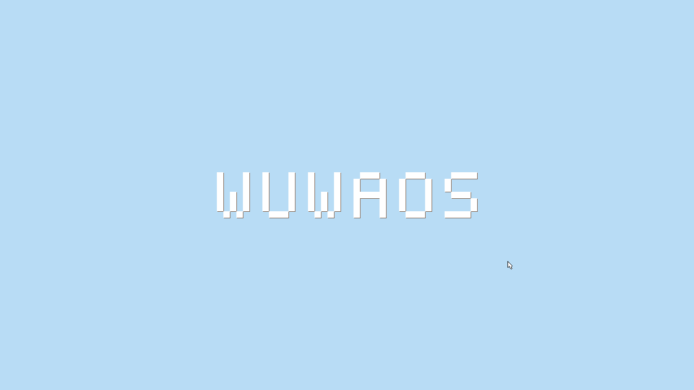

# WUWAOS


WUWAOS is a small operating system written in **C and RISC-V assembly** that boots on a QEMU-emulated RISC-V 64-bit machine. The project explores how processes, scheduling, memory, and file systems work together by implementing a kernel and user programs.

[Documentation website](https://johnson931128.github.io/WUWAOS/) · [Code and architecture guide](docs/CODE_GUIDE.md) · [Specifications and verification](docs/history.md)

## System Overview

| Area | Current implementation |
| --- | --- |
| Platform | QEMU `virt`, RISC-V 64-bit, one CPU core, and 128 MiB RAM; OpenSBI starts the kernel |
| Processes and scheduling | Up to 16 processes, process control blocks, fork, built-in and path-based exec, wait, exit, and timer-driven round-robin scheduling |
| Synchronization and IPC | Custom mutexes and semaphores, sleep/wakeup, per-process file descriptors, and multi-stage pipes |
| Virtual memory | Sv39 three-level page tables, demand paging, FIFO page replacement, and swap |
| File system | VirtIO block device and the custom WUFS file system, with persistent files, shared open-file offsets, and shell redirection |
| User interface | UART shell, `fan` text editor and `workstate` monitor; optional 1280×720 kernel-rendered desktop with a movable pointer on VirtIO GPU/tablet |

WUWAOS focuses on fundamental operating system mechanisms and is not Linux-compatible. QEMU currently loads the kernel using `-kernel`. A restricted static RV64 ELF loader can run compatible WUWAOS programs from WUFS; general ELF/Linux compatibility, command-line arguments for external ELF programs, compiling C inside WUWAOS, networking, a graphical shell, and window management are not supported. The optional graphical mode draws a static desktop in the kernel; the existing shell continues over UART. See the [documentation](https://johnson931128.github.io/WUWAOS/) and [Spec 21](docs/SPEC-21-native-compilation.md) for limitations and future plans.

## Demo Video


The animation plays directly in the README. For playback controls and higher quality, [watch or download the MP4](docs/media/wuwaos-demo.mp4) (about 2 minutes).

The video follows a live QEMU session through the shell, processes, synchronization, pipes, WUFS, `fan`, `workstate`, and virtual memory. It was rendered from terminal output with chapter labels and has no narration; see the [recording details](docs/SPEC-24-demo-video.md).

## Boot Screenshot


*An actual QEMU session in PowerShell. The screenshot is from an earlier version; the current shell prompt shows the working directory, for example `wuwaos/>`.*

## Graphical Desktop

When QEMU has a VirtIO GPU and tablet, WUWAOS draws a 1280×720 pale-blue background, a centered `WUWAOS` wordmark, and a movable white pointer with a dark outline. This is a small kernel-rendered desktop surface; it does not include a graphical shell, desktop server, windows, keyboard UI, or file manager.



On Windows with WSL1, use the loopback VNC target. It listens only on `127.0.0.1`:

```powershell
wsl -d Ubuntu -- bash -lc 'cd /mnt/c/programing/WUWAOS && make run-gui-vnc'
```

In a second PowerShell window, start the Windows TigerVNC viewer and connect to port 5901. Install or download the official [TigerVNC Windows viewer](https://github.com/TigerVNC/tigervnc/releases) first; do not add the viewer executable to this repository.

```powershell
& 'C:\path\to\vncviewer64.exe' '127.0.0.1::5901'
```

For a Linux desktop or WSLg session with a working display, use `make run-gui GUI_DISPLAY=gtk` or `make run-gui GUI_DISPLAY=sdl`. Both GUI targets build/update the WUFS and swap images using the same `disk-image` prerequisite as `make run`; normal guest file writes persist. Do not edit the disk images on the host while QEMU is using them. Stop the VNC run with **Ctrl+C** in its WSL terminal.

## Getting Started

The following example uses Windows PowerShell, WSL Ubuntu, and a checkout at `C:\programing\WUWAOS`. WSL needs Clang, LLD, llvm-objcopy, Make, Python 3, QEMU for RISC-V, and OpenSBI.

Run in PowerShell:

```powershell
wsl -d Ubuntu -- bash -lc 'cd /mnt/c/programing/WUWAOS && make run'
```

`make run` uses Clang in WSL to cross-compile the RISC-V program and then starts QEMU. Once the `wuwaos/>` prompt appears, enter `help` to see the available commands. Try `demo sync` to observe a parent and child process using synchronization primitives.

To exit QEMU, press **Ctrl+A**, release the keys, and then press **X**. The `exit` command ends only the shell. The WUFS disk image is stored at `build/wuwaos.img`; its files persist across restarts, and `make clean` does not delete the disk image.

## Running a WUFS ELF Program

With QEMU stopped, build the existing shell ELF and install it into the WUFS image from WSL:

```powershell
wsl -d Ubuntu -- bash -lc 'cd /mnt/c/programing/WUWAOS && make build/kernel-disk.elf && python3 tools/make_disk.py --image build/wuwaos.img --kernel build/kernel-disk.elf --install build/user.elf /bin/shell.elf'
```

Start WUWAOS with `make run`, then enter `run /bin/shell.elf`. This opens another WUWAOS shell as a child; `exit` returns to its parent. The installer refuses to overwrite existing files. Never modify the image from the host while QEMU is using it.

This first loader accepts a restricted static ELF64 RV64 layout and the WUWAOS syscall ABI; it has no arguments, dynamic linker, or Linux compatibility. See [Spec 26](docs/SPEC-26-elf-exec.md) for the supported layout and validation.

## Documentation

The documentation and course notes linked below are currently written in Traditional Chinese.

- [Getting started and topic chapters](docs/index.md): boot, processes, scheduling, memory, I/O, file systems, and user programs.
- [Synchronization demo](docs/SPEC-23-sync-demo.md): observing mutex and semaphore blocking and wakeup.
- [Code and architecture guide](docs/CODE_GUIDE.md): the responsibilities and design of each source file.
- [Specifications and verification index](docs/history.md): design decisions, verification, and limitations for each stage; older specifications retain their historical context.
- [Course notes](notes/): operating system concepts and terminology.
