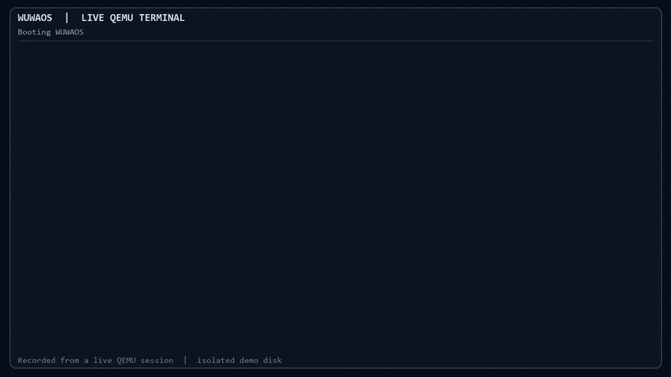
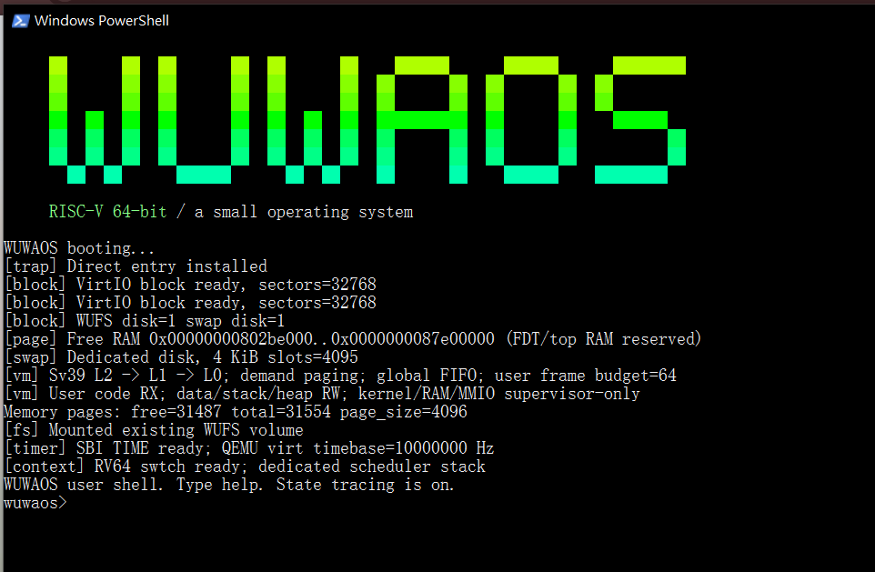
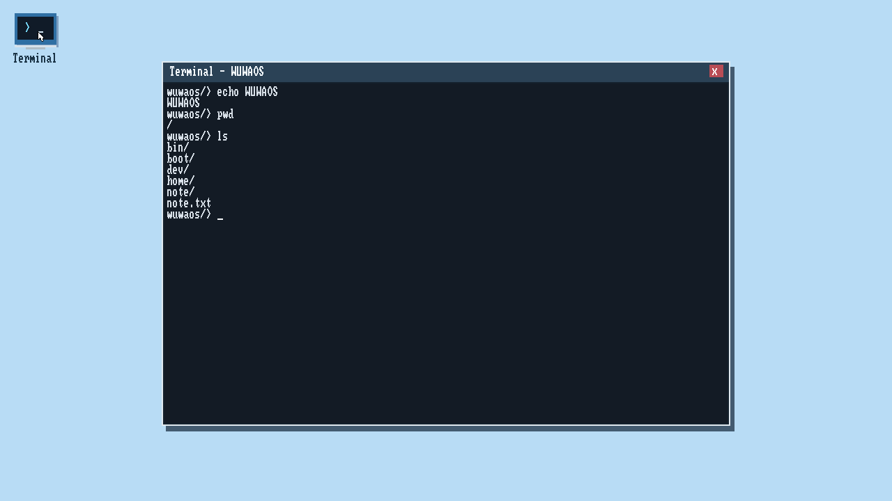

# WUWAOS


WUWAOS is a small operating system written in **C and RISC-V assembly** that boots on a QEMU-emulated RISC-V 64-bit machine. The project explores how processes, scheduling, memory, and file systems work together by implementing a kernel and user programs.

[Documentation website](https://johnson931128.github.io/WUWAOS/) · [Windows portable guide](docs/portable-windows.md) · [Releases](https://github.com/johnson931128/WUWAOS/releases) · [Code and architecture guide](docs/CODE_GUIDE.md) · [Spec 33: modules and UI/kernel boundary](docs/SPEC-33-module-architecture.md) · [Specifications and verification](docs/history.md)

**Try WUWAOS on Windows:** [download the complete portable ZIP](https://github.com/johnson931128/WUWAOS/releases/download/portable-windows-v1/WUWAOS-portable-windows-x64.zip) (about 1.41 GiB), which includes the OS source and its build/run environment. Follow the [PowerShell setup commands](#windows-portable-release) below, then click the desktop's Terminal icon and try `help`, `demo sync`, or `workstate`.

## System Overview

| Area | Current implementation |
| --- | --- |
| Platform | QEMU `virt`, RISC-V 64-bit, one CPU core, and 128 MiB RAM; OpenSBI firmware with CLI disk boot |
| Processes and scheduling | Up to 16 processes, process control blocks, fork, built-in and path-based exec, wait, exit, and timer-driven round-robin scheduling |
| Synchronization and IPC | Custom mutexes and semaphores, sleep/wakeup, per-process file descriptors, and multi-stage pipes |
| Virtual memory | Sv39 three-level page tables, demand paging, FIFO page replacement, and swap |
| File system | Event-waiting VirtIO block requests, WUFS redo journal, atomic file replacement, shared open-file offsets, and shell redirection |
| User interface | UART shell, `fan` and `workstate`; optional VirtIO desktop with up to four independent Terminal windows, focus, dragging, and viewport resizing |

WUWAOS focuses on fundamental operating system mechanisms and is not Linux-compatible. `make run-disk` boots the UART shell from a WUFS disk. A restricted static RV64 ELF loader can run compatible WUWAOS programs from WUFS; general ELF/Linux compatibility, external ELF arguments, compiling C inside WUWAOS, networking, and a file manager are not supported. Window resizing changes the viewport of a fixed 100×30 terminal model; it does not resize the TTY or reflow text. See the [documentation](https://johnson931128.github.io/WUWAOS/) and [Spec 21](docs/SPEC-21-native-compilation.md) for limitations and future plans.

## Current Development Status

The 2026-11-08 implementation adds asynchronous Block requests and swap PTE rollback, nonblocking GPU presentation with bounded recovery, kernel stack guard pages, four independent Terminal windows, and atomic file replacement used by `fan`. Existing isolated TTY sessions, event waits, and owner-aware gates protect shared state. Kernel code can cooperatively sleep and resume its caller stack; timer preemption still applies only to user mode.

These new paths have not been runtime-tested at the user's direction. Boot device setup still polls synchronously. Block reset acknowledgement permits isolating a failed disk; an unconfirmed reset still stops the kernel. GPU recovery can disable the GUI, and stack guards do not provide an emergency trap stack. See the [detailed implementation plan](plan.md) and [compact progress list](plan_current.md) for algorithms, build results, and limits. The existing portable v1 ZIP does not include these source changes.

## Demo Video



The animation plays directly in the README. For playback controls and higher quality, [watch or download the MP4](docs/media/wuwaos-demo.mp4) (about 2 minutes).

The video follows a live QEMU session through the shell, processes, synchronization, pipes, WUFS, `fan`, `workstate`, and virtual memory. It was rendered from terminal output with chapter labels and has no narration; see the [recording details](docs/SPEC-24-demo-video.md).

## Boot Screenshot



*An actual QEMU session in PowerShell. The screenshot is from an earlier version; the current shell prompt shows the working directory, for example `wuwaos/>`.*

## Graphical Desktop

When QEMU has a VirtIO GPU, tablet, and keyboard, WUWAOS draws a 1280×720 desktop with a Terminal icon. Each click opens a new shell window, up to four. Click a window to focus and raise it, drag its title to move it, and drag its lower-right corner to resize its viewport. Closing a window closes its TTY session; `exit` ends the shell and leaves its last display until the window is closed. The original UART shell remains available in `make run`.



The screenshot and portable v1 show the earlier single-window implementation and styling. The current multi-window and asynchronous rendering paths have not undergone visual or runtime validation.

The Terminal accepts US keyboard input including Shift, Enter, Backspace, Tab, Ctrl+D, and arrow keys. Its model remains 100×30 with a subset of ANSI cursor, erase, color, alternate-screen, and visibility controls. Smaller viewports clip cells; larger ones do not add rows or columns. It is a small kernel TTY with no POSIX PTY, clipboard, job control, or Ctrl+C support. [Historical Terminal design and QEMU evidence](docs/SPEC-30-graphical-terminal.md) · [workstate screenshot](docs/images/wuwaos-terminal-workstate.png).

With the Windows portable release, open the desktop from PowerShell using `./Start-WUWAOS.cmd gui`. QEMU runs natively on Windows; a VNC viewer is not needed. See the [portable guide](docs/portable-windows.md) for extraction and build instructions.

On Windows with an existing WSL1 environment, start the desktop and its native viewer with one PowerShell command. The WSL launcher builds the OS, runs QEMU in the background, and closes that QEMU session when the viewer closes:

```powershell
./tools/run-desktop.ps1
```

Install or download the official [TigerVNC Windows viewer](https://github.com/TigerVNC/tigervnc/releases) if one is not already installed or available in `build/tigervnc`. Pass `-ViewerPath 'C:\path\to\vncviewer64.exe'` to select a specific viewer. Add `-Snapshot` to work from temporary copies of the WUFS and swap images; those copies are discarded when the viewer closes. The default uses the project images and preserves guest file changes. The VNC service listens only on loopback; the launcher selects free VNC and QMP ports for each session.

```powershell
# Optional isolated session:
./tools/run-desktop.ps1 -Snapshot
```

For a Linux desktop or WSLg session with a working display, use `make run-gui GUI_DISPLAY=gtk` or `make run-gui GUI_DISPLAY=sdl`. The advanced manual WSL1 path remains `make run-gui-vnc` followed by a Windows VNC viewer connected to `127.0.0.1::5901`. GUI Make targets update the selected disk images before QEMU starts; do not edit images on the host while QEMU is using them. `make run` remains the text-mode UART workflow.

## Getting Started

### Windows portable release

The portable release bundles the WUWAOS source and a Windows x64 toolchain: MSYS2, Clang, LLD, LLVM, Make, Python, QEMU, and OpenSBI. It supports offline compilation and execution without an installer, administrator access, WSL, or changes to the system PATH.

The [Windows portable v1 release](https://github.com/johnson931128/WUWAOS/releases/tag/portable-windows-v1) is a complete source-and-environment bundle for Windows 10/11 x64. Download `WUWAOS-portable-windows-x64.zip`, rather than GitHub's automatically generated **Source code** ZIP. Allow about 8 GiB of free disk space for the download, extracted tools, and build outputs.

**Environment setup from PowerShell:** paste the following commands to download the bundle, verify its SHA-256, extract it into a new `WUWAOS-play` folder under your user profile, and start the desktop. Extraction sets up all the bundled tools; no separate compiler, Python, QEMU, or MSYS2 installation is needed. Use a writable destination with a simple path, avoiding spaces and special characters; change `$destination` if needed. If that folder already exists, choose a new destination to keep existing sessions and files separate.

```powershell
$ErrorActionPreference = 'Stop'
$release = 'https://github.com/johnson931128/WUWAOS/releases/download/portable-windows-v1'
$destination = Join-Path $env:USERPROFILE 'WUWAOS-play'
$name = 'WUWAOS-portable-windows-x64.zip'

New-Item -ItemType Directory -Path $destination | Out-Null
$archive = Join-Path $destination $name
Invoke-WebRequest -UseBasicParsing -Uri "$release/$name" -OutFile $archive
Invoke-WebRequest -UseBasicParsing -Uri "$release/$name.sha256" -OutFile "$archive.sha256"

$expected = ((Get-Content -LiteralPath "$archive.sha256" -Raw) -split '\s+')[0]
if ((Get-FileHash -LiteralPath $archive -Algorithm SHA256).Hash -ine $expected) {
    throw 'Download checksum mismatch. Download the ZIP again.'
}
tar.exe -xf $archive -C $destination
if ($LASTEXITCODE -ne 0) { throw 'Archive extraction failed.' }

Set-Location (Join-Path $destination 'WUWAOS-portable-windows-x64')
.\Start-WUWAOS.cmd gui
```

For a manual download, extract the complete ZIP and open PowerShell in the extracted `WUWAOS-portable-windows-x64` project directory. These commands use the bundled environment:

```powershell
.\Start-WUWAOS.cmd check   # Verify the bundled tools
.\Start-WUWAOS.cmd build   # Compile and prepare fresh disk images
.\Start-WUWAOS.cmd gui     # Build if needed and open the graphical desktop
.\Start-WUWAOS.cmd         # Build if needed and run the UART shell
```

Close the QEMU window to stop the graphical session. For the UART shell, press **Ctrl+A**, release the keys, and press **X**. Stop the existing session before opening another one that uses the same disk images.

The release includes a package/version manifest and SHA-256 checksum. It excludes the original computer's user profiles, cached downloads, signing keyring, and guest disk contents. The first build creates new WUFS and swap images; later sessions preserve guest files. The toolchain supports Windows x64; other hosts need their own tools. See the [portable guide](docs/portable-windows.md) for details and packaging commands.

GitHub's automatically generated **Source code** archives and a normal `git clone` contain only project files; the toolchain is supplied separately in the portable release asset.

### Boot the CLI from a WUFS disk in WSL

The following example uses Windows PowerShell, WSL Ubuntu, and a checkout at `C:\programing\WUWAOS`. WSL needs Clang, LLD, llvm-objcopy, Make, Python 3, QEMU for RISC-V, and OpenSBI.

Open PowerShell and run these commands.

```powershell
cd C:\programing\WUWAOS
wsl -d Ubuntu -- make run-disk
```

This cross-compiles WUWAOS and installs `/boot/kernel.elf` in `build/wuwaos-cli.img`. OpenSBI starts the WUWAOS loader from read-only flash. The loader reads the kernel from the VirtIO disk and starts it. When `wuwaos/>` appears in the same terminal, try `echo hello` or `ls /boot`. Press **Ctrl+A**, release the keys, and press **X** to quit QEMU. The `exit` command ends the shell.

The CLI disk preserves its files across launches and `make clean`. Disk boot uses one WUFS0002 image with swap disabled. If the journal has a pending transaction, use the direct kernel launch in the [WUFS recovery procedure](docs/SPEC-32-wufs-redo-journal.md#新磁碟與-pending-recovery-操作). For everyday direct kernel boot with a dedicated swap disk, run `wsl -d Ubuntu -- make run` from the same directory. That target uses `build/wuwaos.img` and `build/wuwaos-swap.img`.

## Filesystem Initialization Checks

The current source preserves legacy `WUFS0001` images read-only and formats confirmed blank media as `WUFS0002`. WUFS0002 uses a bounded full-sector redo journal with flush barriers and boot-time replay. Unknown nonblank images and images with a pending or invalid journal are never rewritten by the host image tool. These changes postdate portable v1; the existing release ZIP does not include WUFS0002 or the journal and is not rebuilt by this source update. Details, new-disk commands, recovery steps, and scratch QEMU fault-injection results are in [Spec 32](docs/SPEC-32-wufs-redo-journal.md); the older initialization guard is in [Spec 31](docs/SPEC-31-filesystem-initialization-guard.md).

From a source checkout with the portable environment, run these fixed commands in PowerShell:

```powershell
.\Test-FsDisk.cmd valid
.\Test-FsDisk.cmd blank
.\Test-FsDisk.cmd damaged
.\Test-FsDisk.cmd tail
```

Each invocation automatically builds the kernel and creates fresh test disks. Confirm the expected boot message, use read-only commands such as `help` or `ls`, then press **Ctrl+A**, release, and press **X**. The tool checks disk hashes after QEMU exits. `valid` should mount without disk changes; `blank` should gain a WUFS signature; `damaged` and `tail` should refuse formatting and retain identical hashes. The reported `PASS` concerns disk contents; boot messages still need manual confirmation.

See [Spec 31](docs/SPEC-31-filesystem-initialization-guard.md) for the algorithm, exact expected messages, and remaining verification work.

## Running a WUFS ELF Program

With QEMU stopped, use PowerShell in the project root to install the existing shell ELF into the CLI disk.

```powershell
wsl -d Ubuntu -- make build/kernel-disk.elf build/user.elf
wsl -d Ubuntu -- python3 tools/make_disk.py --image build/wuwaos-cli.img --kernel build/kernel-disk.elf --install build/user.elf /bin/shell.elf
```

Start WUWAOS with `wsl -d Ubuntu -- make run-disk`, then enter `run /bin/shell.elf` at the guest prompt. This opens a child shell. Enter `exit` to return to its parent. The installer refuses to overwrite existing files. Stop QEMU before editing the disk from the host.

This first loader accepts a restricted static ELF64 RV64 layout and the WUWAOS syscall ABI; it has no arguments, dynamic linker, or Linux compatibility. See [Spec 26](docs/SPEC-26-elf-exec.md) for the supported layout and validation.

## Documentation

The documentation and course notes linked below are currently written in Traditional Chinese.

- [Getting started and topic chapters](docs/index.md): boot, processes, scheduling, memory, I/O, file systems, and user programs.
- Interactive teaching chapters: [Block Async I/O](docs/topics/block-async.md), [FD/OFD sharing](docs/topics/file-descriptors.md), [paging and swap](docs/topics/paging.md), and [journal/atomic replacement](docs/topics/journal.md). Step through explanatory models alongside parameter and function references; these are not live QEMU traces.
- [Windows portable environment](docs/portable-windows.md): offline builds, native QEMU, packaging, checksums, and Release uploads.
- [Synchronization demo](docs/SPEC-23-sync-demo.md): observing mutex and semaphore blocking and wakeup.
- [Code and architecture guide](docs/CODE_GUIDE.md): the responsibilities and design of each source file.
- [Specifications and verification index](docs/history.md): design decisions, verification, and limitations for each stage; older specifications retain their historical context.
- [Course notes](notes/): operating system concepts and terminology.

## License

WUWAOS's original source code is licensed under the [MIT License](LICENSE). The desktop font uses the [SIL Open Font License 1.1](licenses/Cascadia-OFL.txt). Tools bundled in portable releases retain their individual licenses; see [third-party notices](THIRD_PARTY_NOTICES.md) and the release's package manifest for details.
