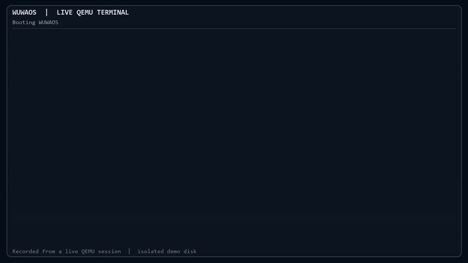
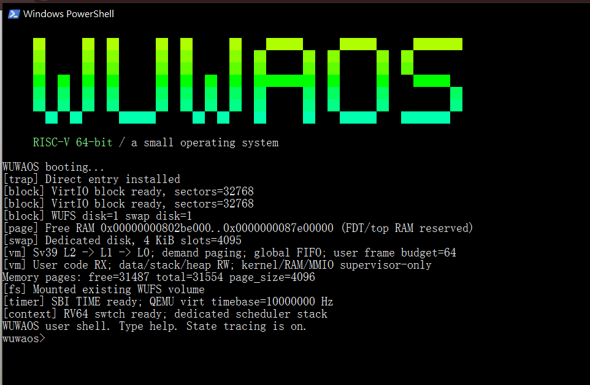

# WUWAOS


WUWAOS is a small operating system written in **C and RISC-V assembly** that boots on a QEMU-emulated RISC-V 64-bit machine. The project explores how processes, scheduling, memory, and file systems work together by implementing a kernel and user programs.

[Documentation website](https://johnson931128.github.io/WUWAOS/) · [Code and architecture guide](docs/CODE_GUIDE.md) · [Specifications and verification](docs/history.md)

## System Overview

| Area | Current implementation |
| --- | --- |
| Platform | QEMU `virt`, RISC-V 64-bit, one CPU core, and 128 MiB RAM; OpenSBI starts the kernel |
| Processes and scheduling | Up to 16 processes, process control blocks, fork, exec for built-in programs, wait, exit, and timer-driven round-robin scheduling |
| Synchronization and IPC | Custom mutexes and semaphores, sleep/wakeup, and a built-in `writer \| reader` pipe |
| Virtual memory | Sv39 three-level page tables, demand paging, FIFO page replacement, and swap |
| File system | VirtIO block device and the custom WUFS file system, with persistent files and directories |
| User interface | A shell, the `fan` text editor, the `workstate` monitor, and the `demo sync` synchronization demo |

WUWAOS focuses on fundamental operating system mechanisms and is not Linux-compatible. QEMU currently loads the kernel using `-kernel`. Loading general ELF executables from disk, compiling C inside WUWAOS, networking, and a graphical desktop are not yet supported. See the [documentation](https://johnson931128.github.io/WUWAOS/) and [Spec 21](docs/SPEC-21-native-compilation.md) for limitations and future plans.

## Demo Video



The animation plays directly in the README. For playback controls and higher quality, [watch or download the MP4](docs/media/wuwaos-demo.mp4) (about 2 minutes).

The video follows a live QEMU session through the shell, processes, synchronization, pipes, WUFS, `fan`, `workstate`, and virtual memory. It was rendered from terminal output with chapter labels and has no narration; see the [recording details](docs/SPEC-24-demo-video.md).

## Boot Screenshot



*An actual QEMU session in PowerShell. The screenshot is from an earlier version; the current shell prompt shows the working directory, for example `wuwaos/>`.*

## Getting Started

The following example uses Windows PowerShell, WSL Ubuntu, and a checkout at `C:\programing\WUWAOS`. WSL needs Clang, LLD, llvm-objcopy, Make, Python 3, QEMU for RISC-V, and OpenSBI.

Run in PowerShell:

```powershell
wsl -d Ubuntu -- bash -lc 'cd /mnt/c/programing/WUWAOS && make run'
```

`make run` uses Clang in WSL to cross-compile the RISC-V program and then starts QEMU. Once the `wuwaos/>` prompt appears, enter `help` to see the available commands. Try `demo sync` to observe a parent and child process using synchronization primitives.

To exit QEMU, press **Ctrl+A**, release the keys, and then press **X**. The `exit` command ends only the shell. The WUFS disk image is stored at `build/wuwaos.img`; its files persist across restarts, and `make clean` does not delete the disk image.

## Documentation

The documentation and course notes linked below are currently written in Traditional Chinese.

- [Getting started and topic chapters](docs/index.md): boot, processes, scheduling, memory, I/O, file systems, and user programs.
- [Synchronization demo](docs/SPEC-23-sync-demo.md): observing mutex and semaphore blocking and wakeup.
- [Code and architecture guide](docs/CODE_GUIDE.md): the responsibilities and design of each source file.
- [Specifications and verification index](docs/history.md): design decisions, verification, and limitations for each stage; older specifications retain their historical context.
- [Course notes](notes/): operating system concepts and terminology.
