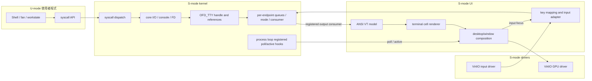

# WUWAOS 程式碼與架構紀錄

記錄目前所有手寫程式碼、標頭、連結及建置設定。現行設計由 SPEC.md 與後續規格組成；記憶體以 SPEC-10、計時器與 RR 政策以 SPEC-15、核心上下文切換以 SPEC-16 為準。各階段驗收保留當時紀錄，不代表現在的全部限制。依主題閱讀可從[文件首頁](./index.md)開始，開發階段見[歷史索引](./history.md)。
術語第一次出現附中文用途。原始碼與實際 QEMU 執行是行為依據，尚未執行的路徑不稱為已驗證。
目前模組目錄與 UI/core 邊界另見 [Spec 33](./SPEC-33-module-architecture.md)。舊 Spec 中引用的舊 source path 固定指向 2026-11-07 重整前的 commit `800a805`；不要將歷史程式碼路徑當成目前位置。

## 1. 架構與控制權

```text
QEMU → OpenSBI（機器模式韌體）
  → arch/riscv/entry.S：準備監督模式核心的執行環境
  → kernel/boot/main.c：安裝例外入口、UART 開機字樣、FDT 探測、核心映射、PID 1
  → 有 GPU/tablet/keyboard：建立 framebuffer、繪製桌面 Terminal 圖示、排程器輪詢輸入事件
  → process_start → swtch → scheduler_loop → swtch → first_run → user_enter → sret
  → user/lib/entry.S → user_main(0) → shell_main
      → 顯示 wuwaos>，以 read 等待輸入
      → scheduler 的 io_poll 輪詢 UART 並通知 TTY event；shell 在原 syscall stack 醒來後取字元、完成一行
      → user/shell/shell.c 解析指令
      → user/lib/api.c 的 ecall → arch/riscv/trap.S → arch/riscv/trap.c → kernel/syscall/syscall.c
          ├─ kernel/proc/process.c → kernel/proc/scheduler.c：PCB 狀態／生命週期 → FIFO 就緒佇列
          ├─ kernel/io/io.c：FD／pipe／console 路由及阻塞；GUI console endpoint 經 kernel/io/tty.c
          └─ kernel/fs/fs.c → drivers/virtio/block.c：檔案路徑／WUFS inode → VirtIO → QEMU 磁碟
      → 阻塞／讓出／到期：swtch 保存核心 C 呼叫，交給獨立 scheduler stack
      → 再次派發：swtch 恢復該行程原核心呼叫，process_resume 完成返回準備
      → trap.S 還原同一行程的使用者 frame → sret
```

CPU 執行記憶體中的機器碼，不知道來源檔名。OpenSBI 負責早期平台準備，核心負責頁表、行程、例外與裝置操作，shell 在 U-mode（使用者模式）透過系統呼叫要求服務。

### UI 與 kernel 的資料通道

以下流程中的 kernel、VirtIO driver 與 UI adapter 都在 S-mode；只有 shell/application 在 U-mode。核心以 generation-checked TTY endpoint 隔離各 session 的輸入輸出；FD 經 OFD 保存 endpoint handle 與引用。桌面視窗只負責呈現與輸入轉譯，不擁有核心 queue 或 process 結構；目前 UI 仍只有一個 Terminal view。



`kernel/boot/main.c` 組裝這些既有模組：註冊 TTY 輸出 consumer 與 process event callbacks，並將 GPU pointer bounds 傳給 input driver。視窗啟動透過 kernel-owned terminal service 建立原本的 GUI shell；process cleanup 透過 core I/O/TTY 還原 session，不直接進入 UI renderer。這是目前單一靜態連結 kernel 的程式碼分層，不代表動態模組、微核心或新的 PTY/window manager。

## 2. 所有程式碼檔案

| 檔案 | 責任 |
| --- | --- |
| arch/riscv/entry.S | 核心初始入口、stack（堆疊）、BSS（零初始化資料） |
| kernel/boot/main.c | 串接核心初始化與第一個行程 |
| ui/boot/splash.c / splash.h | WUWAOS 文字圖案、中央向兩側展開、開機短暫延遲 |
| drivers/uart/uart.c / uart.h | UART（序列埠）MMIO 字元收發 |
| kernel/io/console.c / console.h | 核心診斷格式化與 UART/GUI route |
| arch/riscv/trap.S | 切換堆疊、保存／還原暫存器、返回使用者模式 |
| arch/riscv/trap.c / trap.h | 共同例外入口設定、TrapFrame（保存狀態結構）、原因分派 |
| arch/riscv/context.h | KernelContext：112-byte RV64 核心上下文與 C／組合語言配置契約 |
| arch/riscv/swtch.S | context_switch：sd／ld 保存與恢復 ra、sp、s0～s11，ret 至新上下文 |
| kernel/mm/vm.c / vm.h | 各行程頁表、使用者映像、記憶體權限與安全複製 |
| kernel/fs/path.c / path.h、include/path_limits.h | 相對路徑合併與已驗證目錄的正規化；路徑長度上限 |
| kernel/proc/process.c / process.h | PCB（行程控制區塊）、生命週期、RR 派發／搶占、查詢與終止 |
| arch/riscv/clock.h | 共用 rdtime、QEMU 10 MHz 時基與毫秒換算 |
| arch/riscv/sbi.c / sbi.h | SBI BASE／TIME 呼叫，隔離韌體 ABI |
| arch/riscv/timer.c / timer.h | 中斷初始化、時間片到期事件、清除 pending 與計數 |
| kernel/proc/workstate.c / workstate.h | 派發時間累計、系統 busy 總計、安全唯讀監測快照 |
| include/workstate_info.h | 固定容量、版本化的行程 CPU／記憶體快照 ABI |
| user/apps/workstate/workstate.c / workstate.h、user/apps/workstate/main.c | 獨立 workstate image、區間比率、定時休眠與 q 退出 |
| kernel/proc/scheduler.c / scheduler.h | 單向鏈結 FIFO 就緒佇列、入列／取隊首／移除與順序查閱 |
| kernel/ipc/sync.c / sync.h、include/sync_ops.h | 自製 mutex／semaphore、等待佇列與行程離開清理；詳見 Spec 22 |
| kernel/exec/elf.c / elf.h | 驗證並載入受限 RV64 ELF 段，準備私有 VM；見 Spec 26 |
| user/shell/sync_demo.c / sync_demo.h | shell 的同步示範：父子行程、等待狀態與資源回收 |
| kernel/io/io.c / io.h | FD/OFD、canonical line assembly、WUFS file descriptor、pipe ring、pending I/O 與 TTY FD 路由 |
| kernel/io/tty.c / tty.h | generation-checked TTY endpoint handles；各 endpoint 獨立 input/output queues、raw owner、CR/LF 狀態、active/session refs 與輸出 consumer；UART 是固定 endpoint，不含繪圖狀態 |
| kernel/proc/terminal_service.h / event_hooks.h | UI 呼叫的核心 GUI shell service、boot 註冊給 process loop 的 poll/active callbacks |
| drivers/virtio/block.c / block.h | FDT 裝置探索、VirtIO-MMIO 區塊讀寫佇列 |
| drivers/virtio/gpu.c / gpu.h | FDT VirtIO GPU 探測、modern control queue、2D 資源／framebuffer／scanout／dirty rectangle 傳輸 |
| drivers/virtio/input.c / input.h | 依 FDT 探測 VirtIO tablet/keyboard、event queue、SYN_REPORT pointer 與按鍵事件 |
| ui/desktop/desktop.c / desktop.h | 桌布、Terminal 圖示/視窗互動、mouse cursor 與 dirty composition |
| ui/terminal/vt.c / vt.h | ANSI 控制碼 parser、cursor/colors、normal/alternate cell model；不依賴 driver/kernel services |
| ui/terminal/renderer.c / renderer.h | 將 VT cells、glyph 與 terminal cursor 畫到指定 framebuffer 區域；不繪製 desktop frame |
| ui/graphics/primitives.c / primitives.h | framebuffer rectangle、wallpaper、glyph、text、logo 與 Terminal icon primitives |
| ui/input/keymap.c / keymap.h | VirtIO key code 到 US keyboard/ANSI bytes 的映射與 modifier 狀態 |
| ui/assets/font_terminal.h | WUWAOS Terminal 字型：由 Cascadia Mono 衍生的 ASCII 8×16 灰階字形，每像素 4-bit 覆蓋率 |
| tools/make_desktop_font.ps1 | 在 Windows 將官方 Cascadia Mono Regular 字型轉成內建字形資料；一般 OS 建置不必執行 |
| kernel/fs/fs.c / fs.h | WUFS 區塊配置、inode、目錄與路徑操作；非空白磁碟拒絕自動格式化 |
| kernel/lib/memory.c | freestanding（無標準執行環境）建置所需的 byte-wise memset／memcpy |
| kernel/mm/page.c / page.h | 4 KiB 實體頁面空閒串列、配置／回收、配置 bitmap 與頁數查詢 |
| kernel/mm/swap.c / swap.h | 獨立交換區標頭、slot bitmap、4 KiB 換入／換出讀寫 |
| kernel/syscall/syscall.c / syscall.h | 自訂 syscall ABI 分派；console 查詢 syscall 的輸出暫時路由到目前 shell TTY |
| kernel/exec/user_image.S | 把 user.bin、app.bin、fan.bin 與 workstate.bin 四份獨立映像嵌入核心唯讀資料 |
| arch/riscv/linker.ld | 核心入口、記憶體區段與權限邊界 |
| include/syscall_numbers.h | 共用系統呼叫編號、內建程式角色、錯誤碼 |
| include/process_limits.h | 行程與位址空間共用的上限 16 |
| include/vm_limits.h | heap 起點、頁面大小、heap 頁數與常駐頁預算 |
| user/lib/entry.S | 使用者入口，將核心給的角色與可選路徑交給 user_main，返回後 exit |
| user/lib/api.c / api.h | 使用者系統呼叫包裝函式 |
| user/shell/main.c | Shell image 的 user_main 入口 |
| user/shell/shell.c / shell.h | 互動 shell、既有管理命令、fork／run／workstate 操作 |
| user/shell/shell_exec.c / shell_exec.h | 通用 echo／cat／ls／pwd command stage、argv parser、多階段 pipe 與重導向 |
| user/apps/demo/main.c | 獨立 app 映像的 user_main，分派 worker、quick、writer、reader、counter |
| user/apps/fan/main.c | 獨立文字編輯器映像、緩衝區編輯、按鍵解碼、TUI、儲存與退出確認 |
| user/lib/print.c / print.h | 三種映像共用的字串／數字輸出與短寫處理 |
| tools/make_disk.py | 建立／更新 WUFS 磁碟映像中的 kernel.elf，保留其他檔案；拒絕覆寫未知非空白映像 |
| tools/make_swap.py | 建立有格式標記的獨立交換磁碟，可調整 slot 數，拒絕重格式化既有檔案 |
| Start-WUWAOS.cmd、tools/portable-entry.sh | 使用隨附 Windows 環境，自動編譯後啟動 CLI／GUI，或準備建置產物 |
| Test-FsDisk.cmd、tools/test_fs_disk.py | 固定磁碟驗證入口，自動編譯、建立獨立案例、互動啟動與前後 SHA-256 比對 |
| tools/package-portable.py | 將原始碼與已安裝工具打包，排除個人資料、既有磁碟與快取，產生版本清單與校驗檔 |
| user/linker.ld | 使用者映像固定布局與大小限制 |
| Makefile | 交叉編譯、連結、映像嵌入、持久 QEMU 磁碟與啟動；GUI image/serial/name/pidfile 可由 launcher 覆寫 |

AGENTS.md 是協作規則，README.md 是操作說明，docs/ 下為規格與紀錄，.gitignore 排除 build/。標頭定義型別與契約，不是額外可執行程式。磁碟驗證工具使用隨附 Python 與 QEMU，不需要額外測試框架；操作及驗收狀態見 [Spec 31](./SPEC-31-filesystem-initialization-guard.md)。

## 3. entry.S：為什麼先組合語言，再執行 C？

一般應用程式的 main 前有 runtime（執行環境）準備，自己的核心必須自行準備。
`.section .text.entry` 放置入口機器碼，`.globl _start` 匯出入口符號；arch/riscv/linker.ld 的 ENTRY(_start) 指定核心從這裡開始。

1. `csrw sie, zero` 清除 sie（監督模式中斷啟用暫存器）。
2. `csrci sstatus, 2` 清除 sstatus（監督模式狀態暫存器）的 SIE（監督模式中斷全域開關）。同步例外仍可能發生。
3. `la sp, __stack_top` 設定 sp（堆疊指標）；啟動 stack 向低位址成長，16 KiB、16-byte 對齊。
4. 取得 __bss_start／end，逐 byte 清除左閉右開範圍。B 個 byte 時間 O(B)、額外空間 O(1)。所有靜態頁表、PCB 與緩衝區在開機時因此歸零。
5. `call kernel_main` 設定 ra（返回位址暫存器），開始執行 C 核心函式。
6. 若 C 意外返回，進入 WFI（等待中斷指令）迴圈，不落入未知內容。

la 是載入位址的偽指令；__ 開頭符號由 linker（連結器）決定，不是 C 變數。`1b` 指向前面出現的數字標籤 1，`2f` 指向後面將出現的標籤 2。
`.option push/norelax/pop` 保存、設定、還原組譯選項，不操作 stack。Makefile 禁用 relaxation（連結指令改寫），不依賴尚未初始化的 gp（全域資料指標）。

## 4. main.c 與 console.c

kernel_main 先 trap_init、boot_splash、輸出啟動文字與 block_init_from_fdt；再從 FDT 探測 GPU、tablet 與 keyboard，將找到的 VirtIO MMIO 頁登記給 vm_init。GPU 初始化後啟用 input queue，再畫桌面圖示，避免 keyboard 尚未 ready 時漏掉 Terminal icon。沒有三種圖形／輸入裝置時，原本的 UART shell 流程不變。timer_init 查詢 OpenSBI TIME、清除舊事件並開啟 STIE；首次派發設定 50 ms deadline，sret 返回使用者模式後允許搶占。
UART 位址固定 0x10000000，LSR（線路狀態暫存器）offset 5：bit 5 可寫入字元，bit 0 有收到的字元。

- console_putc 使用 kernel 的 GUI route，否則經 `drivers/uart/uart.c` 輸出；UART driver 輪詢可寫狀態後再寫 offset 0。UART 換行由 `kernel/io/console.c` 在輸出前補 CR（回車）。
- console_puts 掃描零結尾字串逐字輸出；console_hex 固定 16 位十六進位；console_number 輸出十進位並處理負數。
- console_getc 非阻塞讀取，有字元回傳 0–255，否則 -1；不在此函式裡等待整行。
- kernel_idle 永久執行 WFI；只有全部回收、無事件可喚醒的阻塞或致命錯誤才進入。等待 shell 輸入不進 WFI，因為本版沒有 UART 中斷。

`drivers/uart/uart.c` 使用 volatile（要求編譯器保留存取）的 MMIO（記憶體映射裝置暫存器）指標；它不是鎖或通用記憶體屏障。UART 輸出耗時 O(N) 加裝置等待，輸入每次檢查 O(1)。

### 開機圖案：ui/boot/splash.c / splash.h

boot_splash 在進入使用者模式前，用 W／U／A／O／S 的 5×7 bitmaps（位元字形）及索引序列組成 WUWAOS。每個點占兩欄空格，利用 ANSI 256 色背景填出實心筆畫，不依賴 UTF-8 字型；七行由螢光黃綠漸變到薄荷綠。加上字母間兩欄間距，圖案 7×70、左側留白 5 欄。
以中點 35 為中心，radius（揭露半徑）由 1 增至 35，只填入 [35-radius, 35+radius) 內的有效字形像素，其餘輸出預設背景空格；每格增加左右各一欄。填色狀態改變時才輸出顏色控制碼，行尾與動畫結束重設，避免 shell 被染色。
每格固定 O(H×W)，共 35 格，沒有配置動態記憶體。這是逐欄揭露圖案，不是變更終端字型或縮放。
ANSI（終端控制碼）ESC[2J 清屏、ESC[H 回到起點重繪，ESC[?25l/h 隱藏／還原游標；最終字樣保留在 shell 上方。
clock.h 的 clock_ticks 共用 rdtime（讀取硬體時間計數器指令），pause_ms 以 clock_ms_ticks 換算每格 32 ms、最後 200 ms，預定延遲合計約 1.32 秒，另加序列輸出時間。動畫發生在 timer_init 前，沒有在動畫中開啟計時器中斷。現行字形驗收見 [Spec 13](./SPEC-13-block-splash.md)，共用時鐘重構見 Spec 15。
此處沒有啟用 timer interrupt（計時器中斷），也不新增延遲 syscall；忙等只發生於開機期間。尚未從 DTB（硬體描述資料）解析時基，限目前 QEMU virt 平台。
不支援 ANSI 的輸出環境可能顯示控制碼；小於 80 欄可能換行影響動畫，非本次驗收範圍。

### VirtIO GPU 桌面：drivers/virtio、ui/ 與 kernel/io/tty

`drivers/virtio/gpu.c` 與 `drivers/virtio/input.c` 解析 FDT 的 `virtio,mmio` 節點，再讀取裝置 magic、版本 2 與 Device ID（GPU 16、input 18）；MMIO 位址從節點 `reg` 取得，不依賴固定 slot。`vm_map_mmio` 將裝置暫存器頁以 supervisor-only（僅監督模式）映射到核心頁表。VirtIO GPU 使用 split virtqueue（分離式佇列）control queue 0，控制命令以 request descriptor 接 response descriptor；單核心同步等待 used index 前進，最長 5000 ms，逾時後停機避免重用仍可能被 DMA 的記憶體。queue 至少需要兩個 descriptor。

GPU 以 B8G8R8X8_UNORM 建立 1280×720 2D resource。`page_alloc_contiguous` 從核心可用實體頁串列找一段連續 900 頁（3,686,400 bytes），作為永久 framebuffer backing；它不在 VM 使用者分頁預算內，也不會被 swap。完成 RESOURCE_CREATE_2D、RESOURCE_ATTACH_BACKING、SET_SCANOUT 後，TRANSFER_TO_HOST_2D 將矩形像素交給裝置，RESOURCE_FLUSH 讓它顯示。每個呈現操作串行完成，因此沒有多個 GPU 命令同時引用暫存 request。

`ui/desktop/desktop.c` 清成 RGB #B8DCF5，再透過 `ui/graphics/primitives.c` 以 5×7 位元字形放大畫出置中白色 `WUWAOS`。16×16 mouse cursor 移動時，先從備份陣列還原舊矩形，再保存新位置底下的像素、繪製黑色外框和白色填色，最後只呈現兩個位置聯集的矩形；此處理會保留被游標遮住的字樣像素。`kernel/boot/main.c` 將 GPU inclusive max bounds 注入 `input_set_pointer_bounds`；VirtIO input driver 只負責讀 tablet config 並保留相同 0…1279／0…719 normalization，不依賴 GPU/UI headers。

目前原始碼移除了視窗右移 6、下移 8 像素的實心陰影，視窗繪製、背景還原與 dirty rectangle 都以本體寬高為界。這項後續調整的編譯及互動驗收尚待記錄；既有圖片及 portable v1 仍保留先前外觀，見 [Spec 30 後續調整](./SPEC-30-graphical-terminal.md#移除視窗硬陰影)。

`drivers/virtio/input.c` 消化 tablet/keyboard event queue，累積 ABS_X／ABS_Y，到 SYN_REPORT 才交出完整 pointer 座標；US key code 到字元/ANSI bytes 的轉譯由 `ui/input/keymap.c` 負責。`ui/desktop/desktop.c` 對桌面圖示、關閉按鈕與 Terminal window 做 hit-test；Terminal 透過 kernel-owned `kernel/proc/terminal_service.h` 請求核心建立 parent PID 為 0 的 shell，將 FD 0/1/2 綁到獨立 GUI TTY endpoint。窗口關閉只隱藏畫面；shell `exit` 後沿用 parent=0 Zombie reaper 路徑回收，下一次點擊再建立 shell。

`kernel/io/tty.c` 擁有 generation handle 對應的 per-endpoint input/output queues、raw owner、CR/LF 狀態與 session refs；UART 使用固定 endpoint。`kernel/io/io.c` 以 `OFD_TTY` 保存 handle，dup/fork 共用 OFD refs，fd 0/1/2 可路由到 endpoint。使用者點擊桌面圖示時，`ui/desktop/desktop.c` 傳入自己的 output consumer/context，呼叫 kernel-owned `process_start_gui_terminal` 建立 shell 與 TTY endpoint；`kernel/boot/main.c` 只初始化 TTY，並註冊 UI poll/active callbacks。TTY output 交給 `ui/terminal/vt.c` 更新 ANSI parser、cursor/colors、normal/alternate cells，`ui/terminal/renderer.c` 僅繪製 cells/glyphs/terminal cursor，視窗外框與 dirty composition 仍由 desktop 管理。`kernel/proc/process.c` 不 include UI header；process loop 保留 `io_poll` 與 UI poll 的先後。關閉視窗只隱藏 view；結束 session 後 stale handle 失效，直到所有 refs 釋放才可回收 slot，重用時 generation 遞增。這些 S-mode 元件仍屬同一靜態連結 kernel，不是新 syscall 或 POSIX PTY。

GUI canonical input 在 Enter 時提交一行，Backspace 編輯目前行，空行 Ctrl-D 產生 EOF；`fan`、`workstate` 使用 raw byte 輸入。每個 GUI session 與固定 UART endpoint 有自己的 input queue、raw owner 與 CR/LF 狀態。`OFD_TTY` 保存 generation handle；dup/fork 共用同一 OFD，fd 1 的 endpoint 決定核心查詢輸出路由。`ps`、`pcb`、`vmstat` 只在 syscall 執行其列印函式期間暫時路由；boot/driver/scheduler diagnostics 與一般核心 console 輸出仍走 UART。UI 目前仍是一個固定 Terminal view，並非多視窗。終端支援 ASCII、基本 SGR 與反白、CSI 游標移動/清除、alternate screen 與游標顯示狀態；它不是 POSIX PTY，沒有 resize、drag、clipboard、job control 或 Ctrl+C。詳細邊界及 QEMU 操作證據見 [Spec 30](./SPEC-30-graphical-terminal.md)。

## 5. trap.S / trap.c / trap.h：硬體事件到 C

| 名稱 | 中文用途 |
| --- | --- |
| stvec | 監督模式陷阱向量暫存器：入口位址及模式 |
| scause | 監督模式陷阱原因暫存器：中斷／例外的原因 |
| sepc | 監督模式例外程式計數器：相關指令位址 |
| stval | 監督模式陷阱額外資訊：依原因提供錯誤位址等資訊 |
| sstatus.SPP | 進入陷阱前的模式，0 表示使用者、1 表示監督模式 |
| sscratch | 監督模式暫存用途暫存器：本核心用它保存使用者陷阱所需的核心 stack 頂端 |

trap_init 安裝 4-byte 對齊的 trap_entry，採 Direct mode（共同入口模式）。哪些事件交給 S-mode（監督模式）由 OpenSBI 的 delegation（陷阱委派）設定決定。
CPU 更新原因／位置／模式並跳至入口，但不自動保存全部一般暫存器，也不會自動安排核心 stack。

trap_entry 用 `csrrw sp, sscratch, sp` 交換堆疊。來自使用者時取得核心 stack；來自核心時 sscratch 原本為 0，交換後再換回，繼續使用原核心 stack。
配置 288-byte TrapFrame，保存一般暫存器、原 sp、sepc／sstatus／scause／stval，清除 sscratch 後呼叫 trap_handler。
trap.h 的數字位移供組合語言使用，C 結構用相同布局；_Static_assert（編譯期布局契約）避免兩邊不一致，並非 runtime 測試。

trap_handler 保存目前行程的 frame，僅在 SPP=0、scause=8 時分派使用者 ecall（環境呼叫指令）。ecall 固定 4 bytes，因此先將 sepc 加 4；其他例外不套用此位移。
使用者其他例外終止該行程，核心錯誤顯示資訊後停止。一般呼叫後透過 process_resume 返回本行程的 frame；阻塞或換下時以 swtch 保存核心呼叫，恢復後才沿原陷阱路徑返回。
使用者 page fault（缺頁例外）12／13／15 則先呼叫 vm_handle_fault；合法按需配置／換入成功後保留原 sepc 重試，非法或無法補頁才結束行程。這不是把所有缺頁當成一般錯誤，也不對缺頁指令套用 ecall 的 +4。
`mv sp, a0` 改用 C 回傳的 frame；trap_restore 寫回 CSR（控制與狀態暫存器）、還原一般暫存器，最後 sret（監督模式陷阱返回指令）。
第一次 user_enter 也復用這份還原流程。每次保存／還原為固定 O(1)，目前不保存浮點／向量狀態，初始使用者狀態停用相關能力。

## 6. vm.c / vm.h：按需分頁、FIFO 與位址空間

Sv39 將虛擬位址拆成 L2／L1／L0 三個 9-bit 索引與 12-bit 頁內位移；每張表有 512 個 8-byte PTE，對齊 4 KiB。kernel_root 共用 supervisor-only 的核心／RAM／UART，以及由 FDT 探測到的 VirtIO block/GPU/input 裝置映射，使用者不能存取這些映射。

| 使用者範圍 | 權限與 backing（重建來源） |
| --- | --- |
| 0x400000–0x404000 | code，RXU，首次存取從 shell／app／fan 內嵌映像載入 |
| 0x404000–0x405000 | data，RWU，首次從映像及零填充初始化 |
| 0x800000–0x801000 | stack，RWU，首次配置零頁 |
| 0x1000000 起，最多 1 MiB | sbrk 保留的 heap，RWU，首次配置零頁 |

只有已保留的合法區域能補頁；heap 最後一個部分頁按頁對齊映射。新建立的行程只先配置私有根表與低位址 L1，不配置使用者頁；L0 表與使用者頁在需要時取得。kernel/root/page-table 頁面常駐、不參與使用者 FIFO 置換。

- VmSpace 保存 root、program、heap_end、缺頁數，以及 262 個 VmPage 補充分頁記錄。spaces[5] 是 metadata，並非預先配置的使用者 RAM；第五欄供 exec 準備新空間。
- VmPage 的 physical 非零表示常駐；slot 非零表示有獨立 swap backing；兩者皆零時由原始映像或零頁重建。dirty 與硬體 PTE_D 合併判斷修改狀態，pins 表示暫時不可換出，arrival 表示本次入駐次序。
- vm_walk 用 `(address >> (12 + 9 * level)) & 511` 逐層取索引，需要時配置下層表。核心 vm_map 僅安裝 4 KiB 映射，拒絕覆蓋既有 PTE。
- resident_page 取得頁框並完整讀取 swap 或填入映像／零頁，成功後才公布有效 PTE；kernel copyout 主動標 dirty，使用者直接寫入則由硬體 D bit 記錄。換入失敗保留原 slot，不公布部分讀取的頁面。
- evict_one 掃描全域補充表，選 arrival 最小、未 pin 的常駐頁。命中不更新 arrival，因此是 FIFO，不是 LRU。dirty 頁寫入八個磁區成功後才撤銷 PTE；clean 頁直接保留既有 backing 或回到可重建狀態。sfence.vma 撤銷舊轉換後才釋放實體頁。
- 使用者常駐預算預設 64 頁、最小可設 8 頁；超過預算或 page_alloc 無可用頁時嘗試置換。沒有可安全換出的頁面回 -12；磁碟失敗回 -5。QEMU RAM 總量仍是 128 MiB。
- vm_handle_fault 依 scause 12／13／15 檢查執行／讀／寫權限，合法者補頁；處理時 pin 住目前指令可能占用的 code 頁，避免 swap full 時 code 與 operand 互相淘汰。trap_handler 成功後重試同一 sepc，不像 ecall 加 4；非法位址／權限回 -14 終止該行程。
- vm_sbrk 只調整合法 heap 範圍；縮小時釋放不再涵蓋的整頁及 slot，空的分頁表暫留到位址空間銷毀。部分頁縮小再擴張不保證既有 bytes 清零。
- vm_clone 複製常駐內容時 pin 來源頁；已換出的內容透過核心常駐暫存頁複製至獨立 slot。未曾使用的頁不需載入，子行程保留相同映像／零頁來源。任何失敗由 process_fork 銷毀不完整子空間，父內容保留。
- vm_destroy 先釋放補充表中所有使用者實體頁與 swap slots，再遞迴回收私有分頁表，跳過共用核心分支。拒絕銷毀 satp 正在使用的根表。exec 成功切換後才銷毀舊空間；Zombie 保留資源直到 wait／孤兒回收。
- user_readable／user_writable 驗證合法範圍與權限，不要求常駐。user_copy_from／user_copy_to 逐頁載入後立即複製，不保留可能被下一次配置淘汰的實體指標；失敗明確回傳。user_read_byte／user_write_byte／user_write_long 是短資料包裝。

FIFO 單輪選擇最多掃描 17×262 個 metadata；複製／換入換出 O(頁面 bytes)，單次轉譯固定三級。swap full 或失效候選者需繼續掃描其他頁，成本可能更高。沒有 COW、mmap、LRU、多 hart 或非同步磁碟 I/O。完整設計與實際限制見 SPEC-10。

### page.c：底層實體頁面配置

目前限 QEMU virt／128 MiB。以 `__kernel_end` 到 FDT 起點間整頁初始化 FreePage 空閒串列，排除韌體、核心、固定核心堆疊與 FDT／頂端保留 RAM。一般配置取串列頭並清零 4096 bytes，回收檢查對齊／範圍／allocated bitmap 後放回串列頭；串列操作 O(1)。`page_alloc_contiguous` 順著空閒串列尋找連續頁段，GPU framebuffer 使用 900 頁；找不到完整連續區段則回傳失敗而不拆散部分頁。這是 pinned 核心裝置 backing，不納入使用者需求分頁或置換。缺頁與 victim 決策屬於 vm.c。

ps 的 free／total 是底層配置池頁數；vmstat 的 resident／limit 是使用者常駐頁政策，兩者不同。pcb 顯示個別空間 resident／swapped／heap_bytes／faults。使用者頁可以已換出但仍保留 swap slot，常駐頁也可以保留 backing slot；slot 在 heap 縮小或行程回收時歸還。

## 7. process.c / process.h：PCB 與生命週期

原本的 Process 結構現在以 ProcessControlBlock 標記，仍只有一份真實狀態。processes[16] 是行程表，kernel_stacks 每欄預留 16 KiB。
PCB 保存 PID／父 PID／角色／狀態／結束碼、頁表與兩種 stack、frame、等待原因／事件通道／子 PID／結果位址、固定 8 格 FD table、event WaitRecord 與 `kernel_call_active`／`kill_pending`。WaitRecord 保存 source generation/sequence、deadline、完成狀態與結果；TTY／pipe 實際 buffer 位址與短期 staging 留在 caller stack，不交由 scheduler poller 使用。UART FD 0／1／2 是固定 sentinel；GUI TTY、pipe 與 file FD 指向全域 OFD 表。
`ready_next` 指向下一個就緒 PCB，`ready_queued` 標示是否已入列；只有 Ready 行程位於佇列，Running／Waiting／Zombie／Unused 不佔據佇列節點。行程表仍保存所有狀態，佇列不複製 PCB。

```text
Unused（可用）→ New（建立中）→ Ready（就緒）→ Running（執行中）
                                 ↑               │
                                 ├── yield ──────┤
                                 │               ↓ sleep / wait / read / write
                                 └── 喚醒 ── Waiting（等待中）
Running／Waiting／Ready → exit／kill → Zombie（待回收） → wait → Unused
```

- create_process 掃描空欄位、分配遞增 PID、清除 PCB／stack、建立私有頁表、設定初始 frame，最後公布為 Ready。頁面不足回 -12 並恢復 Unused；失敗可能消耗 PID，但不占用 PCB 或頁面。
- 初始 a0 存內建角色，sp 是使用者 stack 頂端，sepc 是 0x400000；sstatus 選 U-mode、SPIE=1、SIE=0，讓 sret 後可接收計時器中斷，核心內維持不搶占；停用浮點／向量能力。
- process_init 建立 PID 1 的 shell；process_spawn 只接受 worker／quick，父 PID 為目前行程。
- process_fork 建立尚未公布 Ready 的子 PCB，複製使用者頁及父 TrapFrame，設定子 a0=0、複製 FD table 並增加 OFD 引用後才改成 Ready；父子共用同一個 open-file offset。父回傳新 PID，子從 fork 呼叫後繼續。核心 stack 不複製，子使用新的保存框架。
- process_exec 先拒絕未知 ID，再準備／交換位址空間。清除舊使用者暫存器、設定 sp／入口／a0 角色，保留原本合法的 sstatus、PID／父子關係／核心 stack／FD table，清除等待及 I/O 欄位。切換 satp 後，trap.S 直接恢復新入口，不會返回舊 shell。所有空間共用核心映射，所以切換時目前核心 stack 仍有效。
- transition 統一記錄與更新狀態，進入 Ready 時排到 FIFO 隊尾，離開 Ready 時移除；scheduler_next 已出列的節點不重複移除。trace_enabled 可關閉子行程的追蹤，但不會停用佇列維護。PID 1 與 fan 不輸出逐次狀態紀錄，以免打斷提示字元或編輯畫面，仍有真實狀態供 ps／pcb 查閱。fork 出來但還沒 exec 的 shell 子行程照常記錄。
- PCB 的 context 保存 ra／sp／s0～s11；create_process 設定 first_run 與 frame 下緣作為初始核心入口／堆疊。fork 使用新的核心上下文，exec 保留目前核心 C 呼叫。
- suspend_current 要求 SIE=0 且已離開 Running，停用原事件後以 context_switch 切到獨立 16 KiB scheduler stack。scheduler_loop 在自己的堆疊切核心根表、清除 current_index、輪詢 I/O、回收孤兒 Zombie，再取隊首、增加 dispatches、切頁表並設定新 50 ms 時間片，最後 context_switch 恢復行程核心呼叫。
- process_resume 只切核心根表並輪詢 I/O，必要時暫停當前行程，最後恢復本行程根表並返回自己的 frame。普通 syscall／缺頁恢復不重設 deadline；計時器仍清 pending、增加 preemptions、Running→Ready，再切到排程器；不修改中斷 sepc 或 a0。
- 核心 C 呼叫堆疊會保留，恢復後從原函式繼續，再由 trap.S 還原同一行程的使用者 frame。新行程首次派發走 first_run→user_enter；Zombie 不再返回。
- 沒有 Ready 但有人等待 console 時持續輪詢 UART；沒有事件來源的全部阻塞顯示診斷；全部回收後進 kernel_idle。

process_sleep 等正整數 channel（事件通道），不是睡幾秒；process_wakeup 喚醒同通道所有事件等待者，回傳數量。通知不累積，先通知、後等待不會收到舊事件。
process_wait 僅等待直接子行程；已是 Zombie 就 collect_child，否則記錄目標與結果位址並進 WAIT_CHILD。
子行程結束會使父行程回 Ready；父恢復到 process_wait 的原呼叫堆疊，自行檢查子行程、寫 status、回收並正常回傳 PID。舊 finish_wait 已移除，不再由排程器代填父的 a0。
wait 的 status 可為空指標，否則阻塞前及回寫時檢查完整可寫範圍。驗證失敗時保留 Zombie 供重試。

terminate 由 exit／kill 共用：逐一 close FD、取消 pending I/O、清理等待資訊、保存結果、成為 Zombie，並通知等待自己的父行程。workstate/fan 終止時還復原終端畫面。
process_kill 只接受目前行程的直接子行程，不接受自己、PID 1 或已是 Zombie，結果為 -9；不是完整訊號系統。
父行程退出時子行程交給仍活著的 PID 1，否則無父行程；無父行程的 Zombie 由核心回收。
reap 以 vm_destroy 釋放私有頁面與表、清除 PCB 的根表指標後將欄位改成 Unused；呼叫時必須已切離該根表及堆疊。孤兒回收在 scheduler stack，父 wait 在父堆疊；固定核心 stack 到下次建立才清零。kill 可丟棄沒有持鎖資源的暫停呼叫，未來加入鎖必須重新設計安全取消。

### 查詢與管道

process_list 列出有效 PCB、剩餘欄位與 scheduler_print_ready 的 FIFO 順序；process_inspect 顯示實際頁表、保存指令位置、stack、等待資訊、結束碼、端點、I/O 請求與 ready_queued。
一般管道由使用者 shell 建立 `pipe()`、fork 各階段、以 `dup2()` 接上 FD 0／1，所有階段啟動後再 wait。核心 `SYS_PIPELINE` 保留舊編號但回 `ERR_NO_SYSCALL`，不是現行管道實作。固定 PCB 表大小 P=16，pipe／FD／OFD 各有自己的上限。
同一個核心系統呼叫內不會被其他行程插入，因此各表的引用計數更新不需要額外鎖。候選行程由 FIFO 隊首 O(1) 取出，但 scheduler_loop 仍有 I/O 與 orphan 回收掃描，不宣稱整個派發都是 O(1)。

### context.h / swtch.S：核心上下文

KernelContext 共 14 個 64-bit 欄位，大小 112 bytes；共享偏移與編譯期布局契約避免 C／組合語言不一致。context_switch 在 C 呼叫邊界用 a0 指向舊上下文、a1 指向新上下文，保存 ra、sp、s0～s11，再恢復新值，以 ret 跳到新 ra。單次 O(1)。a／t 等 caller-saved 暫存器由呼叫端依 ABI 保護，使用者完整暫存器仍在 TrapFrame；swtch 不取代 trap.S，也不自行改 satp、sscratch 或 sstatus。堆疊需 16-byte 對齊，核心 SIE 始終為零。pcb 顯示的 context.sp／ra 在 Running 時可能過時。完整設計見 SPEC-16。

### process_sleep_ms：定時等待

Spec 17 增加 WAIT_TIMER：process_sleep_ms 接受 1～60000 ms，記錄硬體 deadline 並保存核心呼叫；scheduler_loop 每輪檢查到期者改 Ready。全員等時間時保持期限輪詢，不走沒有事件來源的永久 idle。尚無中斷驅動的 idle 喚醒；長核心服務可延遲期限。

### workstate：計時、快照與畫面

kernel/proc/workstate.c 在派發前記錄 run_started，suspend_current 切走前將差值累加到 PCB cpu_ticks 與全域 busy_ticks；全域累計不因 reap 減少。快照以同一個 now 補上目前行程尚未結算的時間，不改動原計數。頁面用量透過 vm_get_usage 掃描補充頁表，page_get_stats 讀配置池計數。固定 16 PCB、每空間固定補充頁表上限，快照成本 O(P×每空間頁數)。先檢查 ABI 長度與可寫位址，再安全複製，不公開核心指標。

user/apps/workstate/workstate.c 以 PID 配對兩次快照、計算 ticks 差與牆鐘差，整數長除法產生千分比，顯示一位小數；首張不虛構區間。RAM used=128 MiB-free，RSS 僅使用者常駐頁；核心與保留區不能由各列 RSS 相加得到。workstate_main 取得 raw console、進 alternate screen，經 console_poll 非阻塞讀鍵與 sleep_ms(50) 讓出 CPU，每至少 1 秒重畫，q 後恢復終端。現在它是獨立內嵌 PROGRAM_WORKSTATE image，由 shell fork／exec 執行，會占一個 PCB；exit／kill 都釋放 raw owner。見 SPEC-17 與 SPEC-27。

process_table 先格式化各列，依最大資料長度調整欄寬，再輸出 ASCII 表頭、邊框與資料；數值右對齊、名稱及狀態左對齊，逐行清除剩餘字元。預設寬 77 欄，欄位增長不截斷；較窄視窗或很長數值可能需要加寬終端。RSS(K)／SWAP(K) 的單位是 KiB。

### scheduler.c / scheduler.h：保存 Ready 行程的 FIFO

`ReadyQueue` 保存 `Process *head`、`Process *tail` 與 count。節點鏈結直接放在 PCB，無需 malloc 或額外複製行程資料。
`scheduler_enqueue` 先檢查 ready_queued 防止重複入列，再接到 tail；`scheduler_next` 取出 head、清除該 PCB 的鏈結與入列標記，取走最後一個節點時也清空 tail。兩者 O(1)。
`scheduler_remove` 尋找指定 PCB 的前一個節點，再重接鏈結；同時處理隊首、中間、隊尾與唯一節點，耗時 O(P)。kill Ready 行程與管線建立失敗回收時，透過 transition 移除節點，避免欄位重用後仍被舊鏈結排程。
排程順序依實際入列時間，同一輪 wakeup／I/O 完成按 PCB 掃描順序入列，不按 PID 排序。佇列仍採 FIFO，政策改為 50 ms RR；核心全域中斷關閉，因此無核心資料修改到一半被搶占，尚無多核心鎖。長核心操作可延後到期中斷，不是精確 CPU 時間統計。
參考筆記：`notes/ch5 CPU schedueling.md`「Round-Robin 理論觀念」與非搶占式核心。counter 仍主動 yield，其交替本身不是計時器證據；Spec 15 以既有無 yield 指令迴圈驗證真正搶占。ps 顯示時間片／中斷數，pcb 顯示派發／搶占數。

## 8. io.c / io.h：行輸入與真實管道

### 終端行輸入

io_read 先驗證 fd（描述號）、長度與完整可寫範圍。fd0 未接管道時接受 2–128-byte 行輸入請求。
TTY read 在 caller stack 上以 event snapshot→讀取 readiness→必要時 wait→醒來 retry。`io_poll` 只輪詢 UART 並 notify，console_read_line 在原 process stack 收集字元、回顯並處理 CR／LF 與 Backspace。CR 後的 LF 會忽略；超長行丟棄到換行後回傳錯誤，不執行截斷命令。Ctrl+D（EOT）空行時回 EOF=0，行內有內容時回傳目前字元但不附換行；raw mode 不特殊處理。

`console_mode(1)` 取得 endpoint 的 raw input owner。持有者 read(0, buffer, 1) 在原 process stack wait/retry，取得一個 byte 後直接複製、不回顯，不要求 Enter。其他 endpoint 讀取者（包括已掛起的請求）回 -16，避免讀走編輯器按鍵；fork 不繼承持有權，exit／kill／成功 exec 釋放它。切換時略過 shell 命令 CR 後尚未消耗的 LF。這是自訂的簡化介面，沒有完整 termios、信號與前景 process group。

### FD、OFD 與 Pipe 環形緩衝區

每 PCB 有 8 格 FD table，UART FD 0／1／2 是不占 OFD 的固定 console sentinel；GUI TTY、pipe 與 file FD 指向全域 16 格 OFD。OFD 可保存 TTY generation handle、一般檔案 inode／共享 offset／讀寫權限，或 pipe 的讀端／寫端。GUI fd 1／2 共用 writable TTY OFD；dup／dup2 與 fork 增加 OFD 引用，同一描述共用 offset／endpoint；exec 保留描述，close／exit／kill 減少引用。open 與 pipe 選最小可用 FD，標準描述關閉後其槽位可重用。

`pipes[8]` 各有固定 256-byte 資料陣列、reader／writer OFD 參照、`read_at`／`write_at` 與 `count`。寫 byte 後索引對 256 取餘數，讀取相反；傳輸 N bytes 耗時 O(N)，儲存固定 O(256)。pipe syscall 同時配置 read/write OFD；dup／fork 只增加 OFD 引用，不複製 ring。

- `io_read`／`io_write` 先按 OFD 類型與方向驗證，再檢查使用者記憶體權限；console、pipe 與 WUFS regular file 使用相同 FD 呼叫。
- pipe 空且尚有 writer 時讀取 pending；無 writer 且資料已讀完回 EOF 0。滿時寫入 pending；無 reader 回 -32。pipe 讀寫允許短讀／短寫，使用者可循環處理。
- file OFD 的 read offset 增加實際讀取量；write 使用 RMW sector 保留未改 bytes，`O_APPEND` 每次從目前 EOF 寫入並更新共享 offset。開啟中的 inode 不可透過 rm／rm tree／cp 覆寫／truncate 釋放或換代。
- pipe read/write 在 caller stack 上重試操作；usercopy 成功後更新 ring 並 notify。`io_poll` 僅 harvest UART bytes 並 notify input source，不掃描 PCB 代替行程搬移資料。
- close／exit／kill 經 OFD 引用計數更新 pipe reader／writer。最後 writer 關閉且 ring 變空才回 EOF；最後 reader 關閉會讓 writer 回 -32。

固定容量限制為每 process 8 descriptors、全域 16 OFD、8 pipes；建立／繼承／關閉在單核心核心區間內完成，不需要額外鎖。Shell 每行最多 3 個 stages；各 stage 用標準 FD，建立後關閉所有額外端點。

## 9. block.c 與 fs.c：I/O 層和檔案系統

這兩層的關係是：檔案系統把路徑和檔案位移轉成磁碟區塊編號；block driver（區塊裝置驅動）負責把指定 512-byte sector 讀入記憶體或寫回 QEMU 磁碟。檔案內容、inode、目錄等格式由 WUFS 管理，VirtIO driver 不理解檔名。

kernel_main 從 OpenSBI 傳入 a1 的 FDT（硬體裝置樹），block_init_from_fdt 搜尋 `virtio,mmio` 節點與 reg（裝置暫存器位址），再檢查 magic、Version 2 與 Device ID 2（block）。virtio-mmio 有多個空插槽，所以逐一略過未接裝置與非 block 裝置，不假設磁碟固定在某個位址。`vm_map_mmio` 將找到的那一頁加入核心監督模式映射。

現行驅動最多初始化兩顆 block 裝置，每顆 BlockDevice 各自保存 descriptor／available／used 佇列與完成計數；同步請求切換 active context，不共享佇列狀態。讀取 LBA 0 的 WUFS0001、WUFS0002／WUSWAP01 標記區分檔案系統與交換區，交換磁碟先接或後接皆可。每顆找到的 MMIO 頁都加入核心映射；block_read/write/flush 只走 WUFS 裝置，block_swap_read/write 只走交換裝置。

swap.c 驗證 4 KiB slot 標頭與磁碟容量，以 bitmap 配置 1-based slot；0 表示不可用／已滿。每頁讀寫八個連續 512-byte 磁區。make_swap.py 預設建立 4095 slots／16 MiB，--slots 可調整，既有映像只驗證、不覆寫格式；slot bitmap 是本次開機的使用狀態，不保存重啟前行程。

driver 協商 VERSION_1 與裝置提供的 FLUSH feature，選 queue 0，建立 request descriptor（描述項）與 status byte，寫入 available ring、通知裝置並同步輪詢 used index。一次只送一個請求；沒有中斷、佇列併發、DMA IOMMU 或 block cache。WUFS0002 commit 使用 VirtIO FLUSH 作持久性屏障；不提供 FLUSH 的裝置只能唯讀掛載乾淨的 WUFS0002。

單次請求以 `block.h` 的 BLOCK_IO_TIMEOUT_MS 設定門檻（預設 5000 ms），公布 available.index 前讀 rdtime（硬體時間計數器）保存 start。未完成時計算 unsigned 的 now-start，依 QEMU virt 10 MHz 時基比較門檻；到期再讀一次完成索引，仍未完成才印出裝置／角色／讀寫／磁區／經過時間與佇列計數。診斷後關閉監督模式中斷並停在 kernel_idle，不返回、不回收或重用尚可能被裝置 DMA 存取的緩衝區。這是單筆請求的 fail-stop，不是整檔／整頁總逾時，也沒有取消、重試或裝置 reset；初始化設定代數與 UART 等其他輪詢不在範圍。設計與操作紀錄見 [Spec 12](./SPEC-12-block-timeout.md)。

WUFS0002 在 LBA 0 存 superblock；LBA 1 是 journal header，LBA 2–10 是 1152 個 redo LBA 的表，LBA 11–1162 是各 512 bytes 的 payload；其後為 inode bitmap (1163)、block bitmap (1164–1171)、固定 inode 表 (1172–1191) 與資料區 (1192 起)。inode 80 bytes，含類型、檔案長度、8 個直接區塊和 8 個單層索引區塊；每檔上限 (8 + 8×128)×512 = 528384 bytes。inode 表固定 128 個項目；16 MiB 磁碟有 32768 個 sector。WUFS0001 保持舊版布局且唯讀掛載，不做原地升級。

`inode_read`／`inode_write` 依 inode 的 byte offset 逐磁區複製，每段長度取磁區剩餘空間與 inode 剩餘長度的較小值。例如 inode 6 從區內位移 480 開始，先處理 32 bytes，再處理下一磁區的 48 bytes。交易內 write 會覆寫 RAM staging sector，並讓後續 read 看見新值；此時不寫 home LBA。

目錄內容是順序 DirectoryEntry（24-byte 名稱 + 4-byte inode 編號），路徑查找從 root inode 逐層掃描目錄。`fs_list` 回傳目錄名稱，`fs_mkdir` 建立目錄及 `.`／`..`，`fs_touch` 建立空檔，`fs_read` 依位移讀資料，`fs_write` 在一筆 transaction 中釋放舊區塊、寫入新檔案資料並更新 inode 長度。

`fs_remove`、`fs_remove_tree`、`fs_copy` 與建立／寫入／truncate 的公開修改入口均以一筆 transaction 包住；修改中的 metadata 與 data sectors 都進入同一 bounded redo log。`fs_copy` 建立新 inode、複製資料、替換或發布目錄項並釋放舊 inode，commit 前任何錯誤都丟棄 RAM staging。每筆最多 1152 個不同磁區，超過回 `-28`，home 磁碟仍未改寫。提交後 home checkpoint I/O 失敗會令本次開機 volume offline；重啟時先驗證完整 log，再 redo 全部 home sectors。

`tools/make_disk.py` 在首次使用時建立 WUFS0002 目錄與 `/boot/kernel.elf`；更新前先拒絕 pending/invalid journal，並驗證 layout、bitmap、inode、pointer 與目錄樹。它在同目錄暫存完整映像、flush/fsync 後 replace，保留其他使用者檔案。WUFS0001 只唯讀保留，不更新 kernel 副本；需用新 `DISK_IMAGE` 建立 V2。`/boot/kernel.elf` 是一般核心 ELF 檔案副本；QEMU 目前仍以 `-kernel` 載入另一份 ELF，磁碟檔案沒有參與開機。`kernel-disk.elf` 以 strip-all 減少儲存副本大小，實際啟動 `kernel.elf` 保留 debug symbols。

路徑型 syscall 與 Spec 27 的 FD/OFD 介面並存，已有各行程 cwd（目前目錄）、相對路徑及 `open/close/read/write` 檔案描述號；這仍不是完整 POSIX VFS。核心複製可跨合法使用者頁面，包含按需載入與 swap。每次 FD write 最多 512 bytes，分次呼叫各自交易；`O_TRUNC` 和後續 write 不是同一筆操作。fan 一次整檔 SYS_FS_WRITE 由單一 transaction 保護。VirtIO request timeout仍沿用 fail-stop 核心停止策略。

`fs_init` 先清除掛載狀態。magic 不符時，`disk_is_blank` 使用 512-byte 緩衝區掃描整顆磁碟，回傳全零、非空白或讀取失敗；只有全零可進入 formatter。讀取失敗、非零資料及容量介面的飽和值都會拒絕自動格式化，格式化失敗也會清除掛載狀態。正常 magic 仍走既有 superblock 欄位驗證；這不是完整 fsck。

主機的 `make_disk.py` 也檢查未知非空白映像、WUFS0002 pending journal 與 metadata 完整性；不會在 kernel 啟動前清除/覆寫它們。固定入口 `Test-FsDisk.cmd` 的初始化保護見 [Spec 31](./SPEC-31-filesystem-initialization-guard.md)；交易和故障驗收見 [Spec 32](./SPEC-32-wufs-redo-journal.md)。

## 10. syscall.c、共用編號與使用者 API

WUWAOS 自訂 ABI（呼叫約定）：a7（呼叫編號暫存器）、a0–a2（參數暫存器）、a0（返回值暫存器）。不是 Linux 編號。

| 編號 | 介面 | 核心服務 |
| --- | --- | --- |
| 1–3 | write、getpid、exit | I/O、目前 PID、退出 |
| 4–8 | spawn、yield、sleep、wakeup、wait | 行程生命週期 |
| 9 | ps | 有效 PCB 列表 |
| 10 | pcb(pid) | 特定 PCB 保存資料 |
| 11 | kill(pid) | 終止直接子行程 |
| 12 | read(fd, buffer, length) | console 行輸入／raw byte／pipe byte 讀取 |
| 13 | pipeline(pids) | 固定 writer／reader 建立 |
| 14 | trace(enabled) | 開關子行程追蹤 |
| 15 | fork() | 複製使用者執行狀態，父返回子 PID、子返回 0 |
| 16 | exec(program_id) | 以內建 app 替換當前程式，成功不返回舊映像 |
| 17 | fs_list(path, buffer, capacity) | 將目錄項目文字複製到使用者緩衝區 |
| 18 | fs_mkdir(path) | 建立目錄 |
| 19 | fs_touch(path) | 建立空檔案或確認既有檔案 |
| 20 | fs_readfile(path, buffer, capacity) | 從檔案開頭讀取最多 capacity bytes |
| 21 | fs_writefile(path, buffer, length) | 建立或覆寫檔案 |
| 22 | console_mode(raw) | 取得／釋放逐字元、不回顯的終端輸入模式 |
| 23 | sbrk(increment) | 增減 heap 合法範圍，回傳舊 break；按需配置實體頁 |
| 24 | vmstat(frame_limit) | 0 查閱 VM／swap 統計，正數設定使用者常駐頁預算 |
| 25 | workstate_snapshot(snapshot) | 唯讀行程 CPU／RAM 快照，核心檢查完整結構長度與使用者範圍 |
| 26 | sleep_ms(milliseconds) | 定時等待 1～60000 ms，核心到期後改 Ready |
| 27 | console_poll() | raw console 所有者非阻塞讀鍵：0 無資料，1～256 為 byte 加一 |
| 28 | fs_remove(path) | 刪除一般檔案並回收 inode 與資料區塊 |
| 29 | fs_copy(source, destination) | 複製一般檔案，完整建立新 inode 後發布 |
| 32 | fs_remove_tree(path) | 先檢查目錄樹及行程工作目錄，再由子向父移除並回收；shell 負責確認 |
| 33 | sync(operation, argument) | 自製 mutex／semaphore 建立、操作與銷毀；使用者 API 封裝 |
| 34 | exec_path(path) | 從 WUFS 載入受限靜態 RV64 ELF，成功後取代目前行程映像 |

syscall_dispatch 用 switch 分派；結果填 frame->a0。阻塞服務保留核心呼叫堆疊、切到排程器，恢復後正常回傳真正結果，再走相同的 a0 回寫路徑，不先存 placeholder。
exec 成功時 dispatcher 立即返回，不能把正常返回值 0 再寫進 frame->a0，否則會破壞新程式所需的初始角色參數。失敗才按一般規則回傳錯誤。
filesystem syscall 先複製 NUL 結尾路徑，資料透過可回報錯誤的 user_copy_from／user_copy_to 逐頁處理；過程可能按需配置或從 swap 換入。寫檔前完整取得來源資料，讀取失敗不繼續用不完整 staging 覆寫磁碟。user/lib/api.c 的 syscall3 使用固定暫存器與 memory clobber 執行 ecall，提供各系統呼叫的使用者包裝函式。
錯誤碼包括 -5 磁碟 I/O、-10 沒有直接子行程、-11 PCB／pipe 資源不足、-12 記憶體／交換資源不足、-14 非法記憶體／權限、-16 終端忙碌、-22 非法參數、-32 管道無讀者、-38 未知呼叫。

## 11. user/shell/shell.c、demo.c、app.c、fan.c、print.c

shell 的 memory_command 提供 mem alloc／write／read／free：sbrk 保留頁數；以 volatile 指標填寫整頁及查看首／中／尾 bytes，讓一般互動能觸發真實硬體缺頁。vmstat 與 vmstat limit 呼叫核心診斷介面。這些是使用者可操作工具，不含自動斷言或測試程式。

shell_main 顯示提示、read 一行、tokenize（切分命令）、command（分派），全程在 U-mode 執行。
`pwd` 查詢各行程目前目錄，`cd` 切換且檢查目錄；`ls` 無參數列目前目錄，檔案命令支援相對與絕對路徑。詳見 [Spec 19](./SPEC-19-cwd-shell.md)。`cls` 經 write 輸出 ANSI 清畫面、清捲動歷史與游標回原點序列，不操作磁碟；實際歷史清除由終端決定。
每次提示前 yield 兩輪，足以讓本版 worker（自身先 yield 一次）到達等待點，避免背景文字蓋過新提示；不是通用工作控制或時間片。
tokenize 原地將空白／tab／換行及 | 分開，最多 4 個 token（詞元）。只有 writer、|、reader 的三詞組合啟動固定管線，其他組合不會被當作主機命令。
positive_number 檢查每個十進位數字與 LONG_MAX 溢位；wait_child 顯示結果，run_pipeline 前景等待兩個端點行程。
help、ps、pcb、spawn、fork、run、yield、wakeup、wait、kill、trace、固定管線、ls、mkdir、touch、cat、write 與 exit 的操作詳見 README。`cat` 顯示最多 2048 bytes；若非空輸出最後沒有 LF（換行字元），shell 會補一個換行，避免提示字元緊接檔案內容；不修改檔案本身。

fork_shell 先增加全域 fork_sequence，再 fork。子行程修改自己的全域資料及區域 stack marker，印出子返回值 0，exit(0)；父顯示子 PID，主動 yield 讓子先修改，再顯示自己仍保留的原資料／堆疊值，留下子行程給 wait 回收。這是正常互動命令，不含測試斷言。
run_program 將 worker／quick／counter 轉成 ID，先 fork，只有子分支呼叫 exec；成功不回來，失敗印錯誤並 exit(127)。父立即返回命令列，由使用者觀察、喚醒、終止或回收。

`run_fan(path)` 採前景 fork → exec_arg(PROGRAM_FAN, path) → wait；父 shell 等編輯器退出後自動回收，恢復終端顏色、游標與替代畫面。exec 的 a1 可傳 fan 的路徑指標；dispatcher 在替換前複製並驗證舊地址字串。process_exec 把路徑放在新使用者 stack 的最高 128 bytes，a1 指向它，sp 從此位置向下生長；不是完整 argc／argv 或任意程式載入。

fan.c 的 user_main(program, path) 開檔時讀最多 2049 bytes，超過 2048 或含非 ASCII／LF／Tab bytes 時直接拒絕，不寫回。不存在的檔案先在 RAM 編輯，儲存時才建立。buffer 固定 2049 bytes，插入／刪除搬移後段 O(N)，cursor 是 byte offset，line_start／line_end 與 vertical 掃描換行決定移動，上下移動保留目標欄。

`decode` 用狀態機逐 byte 處理 CSI／SS3 按鍵序列；`handle` 實作一般編輯與未儲存退出確認。`render` 計算垂直／水平視窗，保留 78×20 編輯區，逐行比對畫面快取後只重畫有變動的行，Ctrl+L 強制完整重畫。`save` 對 WUFS 整檔覆寫，完整成功才清除 dirty；失敗保留緩衝區及錯誤訊息。實作與限制見 SPEC-09。

print.c 的 user_write_all 迴圈處理短寫；user_puts 掃描字串；user_number 以除 10 與反轉輸出十進位，支援超過 9 的 PID。print.h 宣告共用輸出，shell.h 只宣告 shell 入口。
`shell_exec.c` 解析 echo／cat／ls／pwd stages、單／雙引號詞元、pipe、`<`、`>`、`>>`；限制整行 128 bytes、最多 3 stages、每 stage 8 個 argv。建立所有 pipe 與重導向檔案後 fork 全部 stage，dup2 接標準 FD，父子都關閉額外端點；父回收全部 children。fork 途中失敗時關閉 FD、kill 並 wait 已建立 children。child 的 exec/setup 訊息寫 fd2。`cat` 無檔名讀 stdin，console 輸出末尾非 LF 時才補顯示換行；pipe／file byte 不變。直接外部 ELF 不傳 argv。

demo.c 的 user_main 只進入 shell；app.c 是另一份獨立映像，依初始 a0 角色分派：1 worker（yield 後 sleep(7)，醒後 exit 0）、2 quick（exit 40）、3 writer、4 reader、5 counter。
counter 先等待通道 9，再讀寫自己初始化為 3 的 volatile 全域 remaining，每次輸出後減一並 yield，至 0 結束。兩份 counter 各自從 3 開始，展示初始化資料與主動輪轉；現行另有硬體時間片，短程式不一定等到到期。
writer 正常輸出 80 bytes，以 user_write_all 處理管道短寫；reader 每次最多讀 12 bytes，等 EOF 後將完整訊息輸出到 console。接收緩衝區有界，不能無限制累積資料。
user/lib/entry.S 保留初始 a0／a1 呼叫 user_main，返回值再交給 exit；exit 如果意外返回就在使用者模式迴圈。

## 12. Linker 與 Makefile

arch/riscv/linker.ld 由 0x80200000 配置 .text（程式碼）、.rodata（唯讀資料）、.data（有初值資料）、.bss（零初始化資料）、啟動 .stack；前 2 MiB 保留給 firmware。
程式碼與唯讀區終點對齊 4 KiB，__text_end／__rodata_end 供 vm 區分 RX／R／RW。__bss_start／end 供啟動歸零，__stack_top 供啟動 stack，__kernel_end 為映像保留終點。
NOLOAD 不攜帶初始化內容但保留記憶體，KEEP 保護入口，ALIGN 決定對齊；限制核心不超過 0x80400000，保留低位址核心開機大小預算。RAM 映射現由多張 L0 動態建立，不再受單張 L0 的 2 MiB 覆蓋範圍限制。

user/linker.ld 的入口固定 0x400000，code／唯讀資料最多 16 KiB，data／BSS 從 0x404000 開始最多 4 KiB；ASSERT（連結期限制）防止超出。stack 由核心映射，不在 user.bin 中。
Makefile 將 entry.S、api.c、print.c、demo.c、sync_demo.c、shell.c、shell_exec.c 連結為 user.elf；app.c 連結為 app.elf；fan.c 連結為 fan.elf；workstate_entry.c 與 workstate.c 連結為 workstate.elf。四者各自有 user_main，不互相連結。shell API 與新 parser 使用 `-Oz` 以維持固定 code 區；所有映像仍受 user/linker.ld 16 KiB code／4 KiB data ASSERT。llvm-objcopy 轉成四份 `.bin`，kernel/exec/user_image.S 的 incbin 嵌入唯讀資料，vm 依程式 ID 複製映像。不是 ELF parser（執行檔解析器）。
`make run` 與 `run-gui`／`run-gui-vnc` 都會先呼叫 `disk-image` target 建立或更新所選磁碟映像，並接上 WUFS 與 swap VirtIO block devices；圖形 target 與文字 target 採相同資料持續保存語意。`DISK_IMAGE`、`SWAP_IMAGE` 可改用其他映像；`run-gui` 預設 `GUI_DISPLAY=gtk`，可覆寫為 `sdl`。`run-gui-vnc` 的 VNC/QMP 預設 port 為 5901/4451，可由 Make 變數調整。Windows WSL1 建議使用 `tools/run-desktop.ps1` 單指令啟動背景 QEMU 與 Windows viewer；它先完成 image build，再以與 `run-gui-vnc` 共用參數的 `run-gui-vnc-session` 啟動 VM，並採動態 loopback ports、獨立 VM name、serial log 和 pidfile。`-Snapshot` 會建置並執行磁碟副本。`make clean` 特意保留磁碟映像；launcher 行為、失敗清理與驗收限制見 [Spec 29](./SPEC-29-desktop-launcher.md)。

磁碟副本使用 llvm-objcopy --strip-debug 產生的 build/kernel-disk.elf，移除除錯段以避免超過 WUFS 單檔容量；完整 build/kernel.elf 保留給 QEMU／GDB。clean 刪除兩份 ELF，映像與使用者檔案保留。
binary 以 0x400000 為起點，若有初始化 .data，會保留到 0x404000 的位址間距；vm 將前 16 KiB 放 code，其後放 data。BSS 不攜帶映像內容，page_alloc 配置零頁保證其初值。

Clang 交叉編譯為 rv64imac_zicsr_zifencei，ABI 為 lp64，LLD 連結；不依賴標準函式庫、浮點呼叫慣例或動態載入器。
-mcmodel=medany 適用高位址核心；-mno-relax／-msmall-data-limit=0 避免 gp 依賴；-ffreestanding／-fno-builtin／-nostdlib 用於裸機執行環境；-fno-pic／-fno-pie 固定位址。
-O2 最佳化、-g 除錯資訊、-Wall -Wextra -Werror 將警告視為錯誤；-MMD -MP 追蹤標頭相依。未來 C 寫法若產生 memcpy 等呼叫，仍需提供實作。
all 建置、run 啟動、clean 清理 build 產物。更改 flags（編譯選項）後需 clean 再建置；$< 是第一個相依項，$@ 是目標，| build 先確保目錄存在。

## 13. 驗證與閱讀練習

早期行程驗收與 QEMU monitor 證據在 SPEC.md；VirtIO／WUFS 磁碟重啟持久性在 SPEC-06；FIFO 與 Ready 行程移除驗收在 SPEC-07；動態頁面／三級表的初期驗收在 SPEC-08，fan 互動操作在 SPEC-09，現行按需分頁／Swap／回收及失敗路徑在 SPEC-10；一般 FD／管道驗收見 SPEC-27；VirtIO GPU/tablet、桌面畫素與游標移動見 SPEC-28。ps／pcb 讀取真實 PCB 與就緒佇列；`writer | reader` 示範需超過 256-byte ring capacity 才能觀察阻塞。
未完成 runtime 驗證的邊界不可等同已測試；沒有新增未經同意的測試程式碼。
可先照 README 操作 worker，對照 saved sepc（保存指令位置）說明恢復後從哪裡繼續；再追蹤 writer 滿管道時的 buffer 位址如何留在 PCB。

計時器與 RR 已在 Spec 15 實作；仍無核心內搶占、多核心、優先權、seek、通用 shell/job control、外部 ELF argv 與前景 Ctrl+C 取消。描述號／OFD／pipe 表固定容量，shell 最多三 stage。若 shell wait 一個永遠不會收到事件的子行程，也無其他行程能通知，會阻塞；先 wakeup 再 wait。

## 官方參考

- [RISC-V Supervisor 規格：特權暫存器與 Sv39](https://docs.riscv.org/reference/isa/priv/supervisor.html)
- [QEMU virt 與 OpenSBI](https://www.qemu.org/docs/master/system/riscv/virt.html)
- [QEMU VirtIO GPU 裝置](https://www.qemu.org/docs/master/system/devices/virtio/virtio-gpu.html)
- [OASIS VirtIO 1.2 規格：GPU 與 input 裝置](https://docs.oasis-open.org/virtio/virtio/v1.2/virtio-v1.2.html)
- [LLVM RISC-V target](https://llvm.org/docs/RISCVUsage.html)
- [Linker script](https://www.sourceware.org/binutils/docs/ld/Scripts.html)
