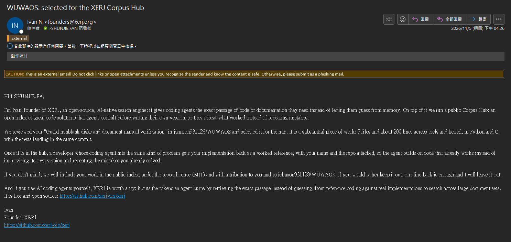

# WUWAOS 實作紀錄

從第一條指令，到能建立行程、編輯檔案的小型作業系統。

WUWAOS 是以 C 與 RISC-V 組合語言撰寫、真正運行於 QEMU 虛擬電腦上的作業系統。這份文件把設計按照主題整理，連接教科書觀念、目前程式碼與可以親手觀察的操作。

**[從環境與啟動開始 →](./topics/getting-started.md)**

Windows 可先下載 [免安裝完整包](./portable-windows.md)，在 PowerShell 使用 `.\Start-WUWAOS.cmd` 啟動 CLI，或加上 `gui` 開啟桌面。最新原始碼的磁碟保護機制與 `.\Test-FsDisk.cmd` 操作見 [Spec 31](./SPEC-31-filesystem-initialization-guard.md)；使用者已確認磁碟保護驗證，這些後續修正不包含在既有 portable v1 ZIP。

## 閱讀路線

| 想理解什麼 | 從這裡開始 |
| --- | --- |
| 原始碼如何分層，UI 如何經 TTY 與 kernel 溝通？ | [程式碼架構](./CODE_GUIDE.md#ui-與-kernel-的資料通道) → [Spec 33](./SPEC-33-module-architecture.md) |
| entry.S 怎麼進入 C，最後顯示提示字元？ | [開機流程](./topics/boot.md) |
| 桌面圖示如何開啟 GUI shell？ | [開機流程](./topics/boot.md#桌面-terminal-與-gui-shell) |
| 使用者程式怎麼請核心幫忙？ | [例外與系統呼叫](./topics/traps.md) |
| 行程如何建立、排程、結束與回收？ | [行程管理](./topics/processes.md) → [計時器與 RR 排程](./topics/scheduling.md) |
| CPU 如何找到資料，缺頁時發生什麼？ | [Sv39](./topics/memory.md) → [按需分頁與交換](./topics/paging.md) |
| 輸入的文字如何存到磁碟？ | [輸入輸出](./topics/io.md) → [WUFS](./topics/filesystem.md) |
| 如何寫自己的互動程式？ | [Shell 與 fan](./topics/applications.md) |
| 如何觀察行程的 CPU 與記憶體用量？ | [workstate 即時監測](./topics/monitoring.md) |

## 目前開發進度

目前以整理核心錯誤處理與共享狀態為主，為後續 UI／視窗功能建立基礎：

- **既有基礎**：多 TTY/session、事件等待、owner-aware kernel gate 與 WUFS redo journal。
- **2026-11-08 已實作**：Block 非同步請求／swap PTE 回復、GPU 非阻塞 present／有界復原、核心 stack guard page、四個獨立終端視窗，以及 Fan 使用的原子檔案替換與統一故障診斷。
- **驗證界線**：本輪依使用者指示不執行測試、不新增測試程式碼。上述新增 runtime、裝置復原、視窗操作及故障結果皆為 NOT_RUN；舊規格的驗收不能替代本輪結果。

詳細步驟、演算法及已執行／未執行的驗收見 [實作計畫](https://github.com/johnson931128/WUWAOS/blob/main/plan.md)；只看進度可讀 [精簡清單](https://github.com/johnson931128/WUWAOS/blob/main/plan_current.md)。這些原始碼更新不包含於既有 portable v1 ZIP。

## 目前的系統邊界

| 項目 | 現況 |
| --- | --- |
| 平台 | QEMU virt、RV64、單核心、128 MiB RAM |
| 執行模式 | S-mode 核心、U-mode 使用者程式 |
| 行程 | 最多 16 個 PCB；fork／exec／exit／wait 與事件等待 |
| 核心上下文 | RV64 swtch.S；每行程保留 C 呼叫堆疊、獨立排程器堆疊 |
| 同步 | 使用者 Mutex／Semaphore；核心 owner-aware gate 保護 OFD／pipe、FS 與 VM |
| 排程 | 單核心 RR、50 ms 時間片；使用者程式可搶占，核心內不被計時器搶占，但可事件等待／合作式切換 |
| 記憶體 | Sv39 三級頁表、4 KiB 頁、按需分頁、FIFO 置換、獨立 Swap |
| 磁碟 | runtime Block event wait；WUFS0002 journal／開機重播與原子替換；reset 確認後隔離故障裝置，不能確認仍 fail-stop |
| 操作 | Shell FD/OFD、三階段管道、檔案重導向、fan 全螢幕文字編輯器 |
| 圖形輸出 | 可選 VirtIO GPU/tablet/keyboard；1280×720 桌面、最多四個獨立 Terminal、焦點／拖曳／viewport 裁切與非阻塞 present |
| 監測 | workstate 全螢幕；每秒更新行程、CPU 派發時間、RSS／Swap 與整體 RAM |

這是目前程式碼的實作紀錄，不承諾 Linux 相容。尚無通用 ELF／Linux 相容、網路或檔案管理器。視窗 resize 只裁切固定 100×30 模型，沒有 TTY resize ABI、文字重排或 clipboard。Stack guard 尚無 emergency trap stack；Block 隔離後不自動重掛，GPU 復原失敗會停用 GUI 並保留 DMA storage。UART shell 保留於 `make run`。目前桌面操作見[開機章節](./topics/boot.md#桌面-terminal-與-gui-shell)，[Spec 30](./SPEC-30-graphical-terminal.md) 與 [Spec 28](./SPEC-28-native-desktop.md) 保留早期驗收。

## 這份文件如何組織

主題章節描述目前設計；[原始規格與驗收紀錄](./history.md) 保留開發過程。舊規格中的架構可能已被後續版本取代，閱讀時應留意每份文件的階段說明。

本站只展示架構說明與操作指令，OS 原始碼以 GitHub 連結提供，不內嵌程式碼。OS 與文件變更經使用者授權提交到 main；網站發布另由專用工具處理。驗收結果是各規格所記錄的當時操作，網站建置不代表重新執行過 OS 驗證。

## 特殊事蹟

2026 年 11 月 5 日收到 XERJ Corpus Hub 來信，表示選中 WUWAOS 的非空白磁碟保護實作，擬以 MIT 授權並附來源的方式作為程式參考。

[查看原圖](https://raw.githubusercontent.com/johnson931128/WUWAOS/main/docs/images/wuwaos-xerj-corpus-hub-email-2026-11-05.png)

## 參考與致意

閱讀版面與循序章節安排參考 [《1000 行打造作業系統》](https://operating-system-in-1000-lines.vercel.app/tw/)。本文內容依 WUWAOS 自己的程式碼整理，沒有複製該書文章。作業系統概念參考 repository 的 `notes/` 課程筆記，各章另列對應檔案；筆記全文不包含在網站中。
