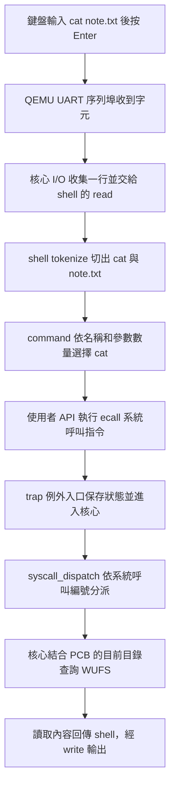

# 10 · Shell 與 fan 編輯器

`ls` 不帶參數時列出目前目錄；`rm /absolute/file` 刪除檔案，`cp /absolute/source /absolute/destination` 複製檔案。`cls` 會要求終端清除畫面和捲動歷史，保留 WUFS 檔案；捲動歷史是否真的清除取決於終端對控制序列的支援。命令範圍與限制見 [Spec 18](../SPEC-18-file-commands.md)。

核心提供能力，使用者程式把能力組合成操作。WUWAOS 的 shell 與 fan 都是 U-mode（使用者模式）程式，透過 syscall 操作行程、終端與檔案。

## Shell 如何執行命令

`user/shell.c` 讀入最多 126 個字元，切成最多 4 個 token（以空白分隔的單位），再比對命令。解析為 O(L)，L 是輸入長度；目前沒有引號、腳本與一般背景工作控制。

在提示字元輸入 `help`，每行會列出一個命令及其參數，右側對齊用途說明；行程、檔案與記憶體操作用空白行分隔。`<path>` 可是相對或絕對路徑，`<page>` 從 0 起算。格式與驗收見 [Spec 14](../SPEC-14-shell-help.md)。

| 操作 | 主要流程 |
| --- | --- |
| ps／pcb | 進核心查詢行程狀態 |
| ls／cat／write／rm／cp | 以路徑呼叫 WUFS 服務 |
| cls | 透過終端控制序列清除畫面及捲動歷史 |
| run counter | fork 子行程，再 exec 指定內建程式 ID |
| writer \| reader | 建立固定管道與兩個端點行程 |
| fan 路徑 | fork → exec fan 並傳入路徑 → 父 shell 等待 |
| vmstat／mem | 查詢與操作使用者記憶體 |

命令和 syscall 沒有一對一關係。以 fan 為例，一次編輯操作可能多次讀取按鍵、輸出控制碼，最後才寫入檔案。

## 命令是如何被「吃進去」的？

以在 `/home/user` 輸入 `cat note.txt` 為例：



1. UART（序列埠）接收終端字元；核心 I/O 完成一行後，shell 的 `read` 拿到文字。
2. shell 的 `tokenize`（切詞）依空白分出命令與參數；`command` 比對第一個詞和參數數量。`cat`、`cd`、`ls` 是 shell 認得的內建命令，不是 Linux 程式，也不代表每個命令都是 syscall。
3. `cat` 呼叫使用者 API 的檔案讀取介面。API 將 syscall 編號放入 `a7`（系統呼叫編號暫存器），參數放入 `a0` 等暫存器，執行 `ecall`（進入核心的指令）。
4. 硬體依 `stvec`（監督模式例外入口位址暫存器）轉到例外入口；核心保存行程狀態後，`syscall_dispatch`（系統呼叫分派器）依編號選擇檔案讀取。核心使用該行程 PCB 的 CWD（目前工作目錄），將 `note.txt` 視為 `/home/user/note.txt`，再逐層查找 WUFS。
5. 核心將資料和結果交回 shell，shell 透過輸出 syscall 印出；`sepc`（例外返回指令位址暫存器）跳過剛執行的 `ecall`，最後 `sret`（返回使用者模式指令）恢復執行。若找不到檔案則顯示錯誤。

`cd` 呼叫 chdir 改變本行程 PCB 的目錄，`pwd` 呼叫 getcwd 取得目錄；`cls` 輸出終端控制序列，`fan` 則 fork 子行程再 exec 對應內建映像。一個命令可以呼叫多次 syscall；目前沒有 PATH 搜尋或一般外部 ELF 程式載入。

## 目錄操作

| 指令 | 功能 |
| --- | --- |
| `pwd` | 顯示目前目錄 |
| `cd`、`cd ~` | 切到 `/home/user` |
| `cd notes`、`cd ~/notes` | 以相對路徑或家目錄路徑進入 |
| `cd ..`、`cd /` | 前往上一層或根目錄 |
| `cd -` | 返回前一個目錄並印出路徑 |
| `ls` | 列出目前目錄 |

初始 shell 從 `/` 開始。spawn、fork 或 pipe 新建的子行程繼承目錄，exec 保留；之後各行程各自管理。目標不存在或不是目錄時不會改變位置。規格與驗收見 [Spec 19](../SPEC-19-cwd-shell.md)。[shell 原始碼](https://github.com/johnson931128/WUWAOS/blob/main/user/shell.c)、[系統呼叫分派](https://github.com/johnson931128/WUWAOS/blob/main/kernel/syscall.c)。

## 三份獨立使用者映像

Makefile 將 shell、app、fan 分別連結為 ELF，再轉成 binary 嵌入核心。`kernel/user_image.S` 保存原始內容，VM 在需要時載入對應頁面。

因此 fan 是真正的獨立行程，但還不是由 `/bin/fan` 磁碟執行檔載入。user/entry.S 將初始參數交給 user_main，返回值再交給 exit。

## fan 的文字資料結構

`user/fan.c` 用連續 byte 陣列存放最多 2048 bytes ASCII／LF 文字，cursor（游標）是陣列中的位移。

例如 `abc` 的游標在 b 前面，插入 X 時，先把後段 `bc` 向右移，再放入 X，得到 `aXbc`。刪除則反方向搬移。插入／刪除最壞 O(N)，對小型文字檔容易理解與管理，不需要複雜樹結構。

上下移動會掃描換行並保留目標欄位；按鍵解碼器逐 byte 處理 ANSI Escape 序列。畫面以逐行快取比較，只重畫改變的行。

## 一個終端上的全螢幕介面

畫面經 UART 輸出 ANSI 游標定位、清行與色彩控制碼，需至少 80×24 終端。它是 TUI（文字使用者介面），沒有 framebuffer（像素畫面緩衝區）或圖形視窗系統。

編輯器持有 raw console，shell 等待子行程，不會同時讀走你的按鍵；背景行程輸出仍可能干擾畫面，尚無完整前景工作隔離。

## 在 QEMU 編輯

```text
fan /home/user/note.txt
```

| 按鍵 | 操作 |
| --- | --- |
| 方向鍵／Home／End | 移動游標 |
| Enter／Tab | 換行／插入空白 |
| Backspace／Delete | 刪除文字 |
| PageUp／PageDown | 捲動畫面 |
| Ctrl+O | 儲存 |
| Ctrl+X | 離開；修改未儲存時詢問 y／n／c |
| Ctrl+L | 完整重畫 |

輸入文字，Ctrl+O 儲存，再 Ctrl+X 返回 shell，使用 `cat /home/user/note.txt` 讀回。新檔直到儲存才建立，父目錄必須存在。

## 限制與參考

UTF-8、超大檔案與不支援的控制字元會拒絕開啟，以免截斷覆寫。既有 Tab 以 `>` 顯示並保留，新 Tab 插入空白。目前沒有 undo、搜尋、Vim 命令模式與原子儲存。

觀念參考：`notes/ch3 Process.md`、`notes/ch12  I_O Systems.md`；終端序列依 [XTerm 文件](https://invisible-island.net/xterm/ctlseqs/ctlseqs.html)。設計與既有互動驗收見 [Spec 09](../SPEC-09-fan.md)。
