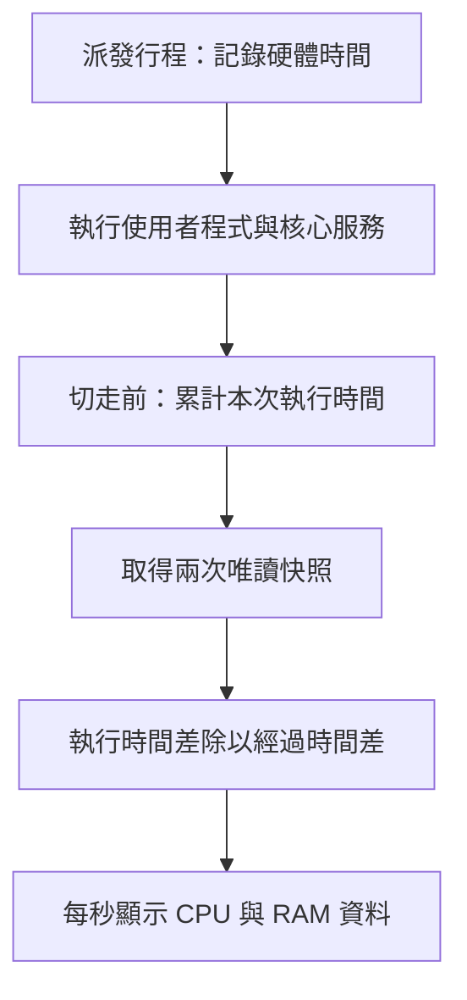

# 11 · workstate 即時監測

在 WUWAOS shell 輸入 `workstate`，會開啟終端全螢幕的行程監測，每秒更新、按 q 或 Q 返回原 shell。第一張的 CPU 顯示 sampling，取得下一個時間區間後才顯示百分比。

## 畫面有哪些資料

| 欄位 | 意義 |
| --- | --- |
| PID／PPID、NAME、STATE | 行程編號、父行程、內建程式名稱與真實 PCB 狀態，包含 Waiting／Zombie |
| CPU% | 最近兩次畫面快照之間，被派發執行的時間比例 |
| CPU ms | 從建立以來累計的派發執行時間，fork 子從零開始，exec 保留 |
| RSS KiB | 目前仍在 RAM 的使用者頁面，不含核心堆疊與頁表 |
| MEM% | RSS 除以平台的總 RAM，目前為 128 MiB；小行程可能顯示 0.0%，可看 KiB |
| SWAP KiB | 已換出而不常駐 RAM 的使用者頁面 |

上方 RAM used 包含核心、頁表、OpenSBI 與 FDT 等保留區，不等於各列 RSS 相加。Reserved/static 是未進入動態配置池的部分。Swap slots 也包含常駐頁仍保留的交換區備份，所以不一定等於表格的 SWAP KiB 總和。

## CPU 是怎麼算的



CPU task 是排程工作占用率：包含行程被派發期間的使用者程式、syscall 與缺頁處理，排隊或阻塞等待不算。它不是宿主 Windows／QEMU 的 CPU 負載。idle/scheduler 包含排程開銷與目前 UART／期限輪詢；硬體可能仍在忙等，不能用這個值推論節電。

各列按 PID 配對計算，避免回收後重用 PCB 欄位產生錯誤差值。整體累計保留已退出行程的時間，因此剛退出或回收時，整體百分比不一定等於目前可見各列總和。

## 監測者本身也需要資源

workstate 是 shell 內的功能，所以表格中的 shell 就包含監測畫面的開銷，不額外占用一個 PCB。它取得 raw console，檢查鍵盤後以 sleep_ms 休眠 50 ms，再檢查更新時間；不在使用者模式持續忙等一秒。

目前定時等待仍由核心排程迴圈檢查 deadline。同步磁碟 I/O 或其他行程的時間片可能延後畫面更新與 q 的處理，不是即時期限保證。其他行程的終端輸出可能交錯，下次更新會重畫。

## 操作與原始碼

```text
spawn worker
spawn quick
workstate
```

可以同時看到等待中的 worker 與待回收的 quick。按 q 回 shell 後，以實際 PID 執行 wakeup／wait／kill。既有 counter 會主動 yield，短工作可能在一秒取樣前就結束，不必然顯示高 CPU%。真正無 yield 的觀察驗收使用既有映像中的迴圈與 QEMU 偵錯介面，見 [Spec 17](../SPEC-17-workstate.md)，沒有新增測試程式。

原始碼：[使用者畫面](https://github.com/johnson931128/WUWAOS/blob/main/user/workstate.c)、[核心快照與計時](https://github.com/johnson931128/WUWAOS/blob/main/kernel/workstate.c)、[共用資料格式](https://github.com/johnson931128/WUWAOS/blob/main/include/workstate_info.h)。概念參考 notes/ch3 Process.md、ch5 CPU schedueling.md 與 ch10 Virtual Momory.md。
