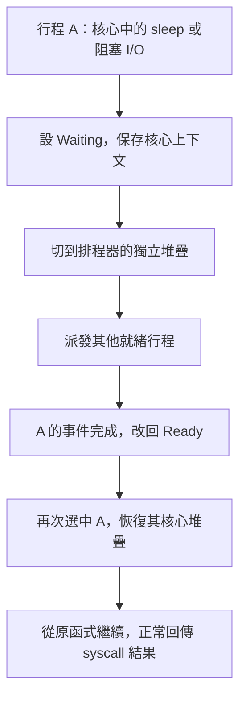

# 04 · 行程管理

程式是一份指令與資料；Process（行程）是這份程式正在執行的一次實例。兩個行程可以執行同一份程式，卻擁有不同 PID、暫存器與私有資料。

## PCB 保存什麼

原始碼：[kernel/process.h（GitHub）](https://github.com/johnson931128/WUWAOS/blob/main/kernel/process.h)。

`ProcessControlBlock` 就是 PCB（行程控制區塊），`processes[16]` 是目前行程表。`page_table` 找到私有位址空間，`frame` 找到暫存器保存狀態；等待與 I/O 欄位記錄阻塞後還沒完成的事。

`ready_next` 是指向下一個 Ready PCB 的指標，不是另一份行程副本。核心堆疊每欄固定 16 KiB；使用者頁面則由 VM 按需要配置。

## 核心函式如何暫停與恢復

現在 PCB 另有 `KernelContext`（核心呼叫上下文），與 `TrapFrame`（使用者陷阱保存狀態）分開。前者保存核心的 ra（返回位置）、sp（堆疊位置）與 s0～s11（呼叫後必須保留的暫存器）；後者保存使用者暫存器與返回使用者模式所需的控制狀態。

原始碼：[swtch.S](https://github.com/johnson931128/WUWAOS/blob/main/kernel/swtch.S)／[context.h](https://github.com/johnson931128/WUWAOS/blob/main/kernel/context.h)。RV64 使用 sd（儲存 64-bit）與 ld（載入 64-bit）；最後 ret 使用恢復後的返回位置。這是函式呼叫邊界的保存，不是任意指令位置的完整中斷保存。



每個行程保留自己的核心 C 呼叫堆疊，所以 wait 被喚醒後能接著檢查子行程並回收，read 被喚醒後能接著回傳真正讀取長度。排程器另有 16 KiB 堆疊，能安全回收已退出行程；不需要在某個退出行程的堆疊上挑選下一個。

新行程沒有舊核心呼叫位置，第一次切入走 first_run，再由 user_enter／sret 進使用者程式。fork 子行程使用新的核心上下文，沒有複製父的核心呼叫堆疊。pcb 的 kernel_context_sp／ra 是上次保存的值，Running 時可能不是目前硬體值。

完整設計與驗收見 [Spec 16](../SPEC-16-kernel-context.md)。這提供後續 Mutex（互斥鎖）與 Semaphore（號誌）的阻塞基礎；核心內仍未開啟強制搶占。

## 狀態怎麼走

```text
Unused → New → Ready → Running
                 ↑        ├─ yield → Ready
                 │        ├─ sleep／wait／阻塞 I/O → Waiting
                 └─ 喚醒 ─┘
Running／Ready／Waiting → exit／kill → Zombie → wait → Unused
```

Zombie（已退出、待回收）仍保留結束結果與資源，讓父行程能透過 wait 取得結果。它已不再執行，也不在 Ready queue（就緒佇列）裡。

## 建立、複製與替換

`create_process` 取得空 PCB，準備頁表與初始 TrapFrame，成功後才公布 Ready。建立中途失敗就回收不完整空間。

`process_fork` 複製父行程的使用者內容與已越過 ecall 的暫存器狀態。父 a0 得到子 PID，子 a0 得到 0。核心堆疊不直接複製；常駐頁與已交換資料都取得獨立內容，目前沒有 COW（寫入時複製）。

`process_exec` 先準備新空間與必要參數，成功後才切換並銷毀舊空間。PID 和父子關係保留，下一次返回使用者模式時從新程式入口開始。

## 在 QEMU 觀察

從新開機開始，逐條輸入：

```text
fork
ps
wait 2
run worker
ps
pcb 3
wakeup 7
wait 3
ps
```

父子應顯示不同的私有 data／stack 值。worker 等待事件通道 7，喚醒後可回收。若先前已建立過行程，請以實際輸出的 PID 取代 2／3；`sleep(7)` 是等待通道 7，不是睡 7 秒。

## 回收與限制

exit 關閉端點並留下 Zombie；wait 取得結果後釋放使用者頁、Swap slots（交換區槽位）、私有頁表及 PCB。孤兒行程另有接管與回收流程。狀態結果寫入父使用者空間失敗時，不會先丟棄 Zombie。

最多 16 個行程（含 shell），exec 仍只選擇核心內嵌的程式 ID，不是載入任意磁碟執行檔。沒有執行緒與完整作業控制。

觀念參考：`notes/ch3 Process.md`。實作脈絡見 [Spec 02](../SPEC-02-process-lifecycle.md)、[Spec 05](../SPEC.md)，目前私有記憶體複製見 [Spec 10](../SPEC-10-demand-paging.md)。

## 同步物件

WUWAOS 以自訂核心物件與 syscall 實作 Mutex（互斥鎖）及 Semaphore（計數號誌），不依賴 POSIX。Mutex 確保單一持有者；Semaphore 用計數管理資源。資源不足時行程阻塞，核心在條件改變時喚醒 FIFO 等待者。

目前單核心、核心內不搶占，這是等待佇列操作不被同時改動的前提。持鎖行程終止或 exec 時，鎖標記為 poisoned（資料可能不一致）；後續取得會回報錯誤。Semaphore 名額不會因持有行程離開自動返還。詳細介面、例外與驗證狀態見 [Spec 22](../SPEC-22-synchronization.md)，[核心原始碼](https://github.com/johnson931128/WUWAOS/blob/main/kernel/sync.c)。

可以在 QEMU 使用 `sync sem create 0` 建立初始值為 0 的號誌，再以 `syncbg sem wait <id>` 啟動等待的子行程。使用 `ps` 看到 Waiting sync，之後以 `sync sem post <id>` 喚醒它，再用 `wait <pid>` 回收。`syncbg mutex hold <id>` 的子行程持鎖等待通道 7，`wakeup 7` 使其解鎖並離開；實際編號以畫面顯示為準。`wakeup 7` 同時喚醒其他等待此通道的行程。

## 用 demo sync 觀察兩個行程

在 `wuwaos/>` 輸入 `demo sync`，shell 父行程會持有 Mutex，建立子行程並顯示 `ps`。子行程取得鎖並釋放後，再等待初始值為 0 的 Semaphore；父行程顯示第二次 `ps`，接著發出 post。最後子行程結束並由父行程回收。行程編號每次可能不同。

此範例用終端輸出展示臨界區域，不是共享記憶體範例。兩次快照前各等待 200 ms，讓子行程有機會執行；快照反映真實狀態，忙碌時不保證剛好看到 Waiting。完成後回收同步物件；若行程欄位不足會顯示錯誤。詳細設計見 [Spec 23](../SPEC-23-sync-demo.md)，原始程式見 [GitHub](https://github.com/johnson931128/WUWAOS/blob/main/user/sync_demo.c)。
