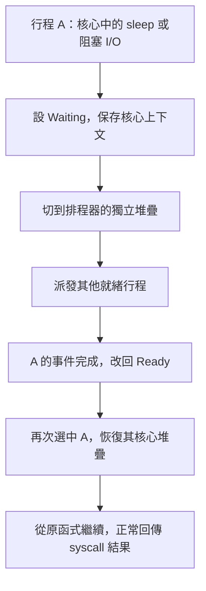

# 行程管理 {#_04-·-行程管理}

對應現行規格：[〈03 · 行程與執行緒〉](../spec/03-processes-and-threads.md)。

程式是一份指令與資料；Process（行程）是這份程式正在執行的一次實例。兩個行程可以執行同一份程式，卻擁有不同 PID、暫存器與私有資料。

## PCB 保存什麼

原始碼：[kernel/proc/process.h（GitHub）](https://github.com/johnson931128/WUWAOS/blob/main/kernel/proc/process.h)。

`ProcessControlBlock` 就是 PCB（行程控制區塊），`processes[16]` 是目前行程表。PCB 保存 `page_table`、FD table、cwd、父子關係與生命週期；`thread` 指向代表 TCB，join／回收後可改變，Process 群組清理完成後可為 null。每 Process 最多占用 8 個 Thread slots，全系統共 32 個；New 與未 join 的 Zombie 也占槽。`frame`、`context`、`event_wait`、執行狀態與核心堆疊屬於各 TCB。阻塞讀寫在原 Thread kernel stack 恢復後繼續，不把使用者 buffer 指標交給 scheduler poller。[B／C 實作與限制](../thread-stage-b.md)

`kernel/proc/gate.c` 的 owner-aware recursive Gate 以 TCB 指標／TID 記錄持有者與深度，等待者以 event sequence 防止漏喚醒。FS、VM、各 OFD 與各 pipe 使用不同 scope；runtime caller 可在等待 Gate 時讓出核心 stack，scheduler/UI poll 不可睡眠。新 PCB 保留 `PROCESS_NEW` slot，TCB 保留 `THREAD_NEW`，等頁表/frame 初始化完成後才發布 Ready；`pcb` 對 null frame 顯示 initializing。

TCB 的 `ready_next` 指向下一個 Ready TCB。每個 Thread 核心堆疊有 16 KiB 可用空間，下方另留一頁 4 KiB guard，從共用核心頁表取消映射；scheduler stack 亦採相同保護。初始化只清可用 stack，不碰未映射 guard。使用者頁面則由 VM 按需要配置。

## 核心函式如何暫停與恢復

TCB 有 `KernelContext`（核心呼叫上下文），與 `TrapFrame`（使用者陷阱保存狀態）分開。前者保存核心的 ra（返回位置）、sp（堆疊位置）與 s0～s11（呼叫後必須保留的暫存器）；後者保存使用者暫存器與返回使用者模式所需的控制狀態。

原始碼：[swtch.S](https://github.com/johnson931128/WUWAOS/blob/main/arch/riscv/swtch.S)／[context.h](https://github.com/johnson931128/WUWAOS/blob/main/arch/riscv/context.h)。RV64 使用 sd（儲存 64-bit）與 ld（載入 64-bit）；最後 ret 使用恢復後的返回位置。這是函式呼叫邊界的保存，不是任意指令位置的完整中斷保存。



每條 Thread 保留自己的核心 C 呼叫堆疊，所以 wait 被喚醒後能接著檢查子行程並回收，read 被喚醒後能接著回傳真正讀取長度。排程器另有 16 KiB 堆疊，不需要在已退出 Thread 的堆疊上挑選下一個或回收該 Thread。

新行程沒有舊核心呼叫位置，第一次切入走 first_run，再由 user_enter／sret 進使用者程式。fork 子行程使用新的核心上下文，沒有複製父的核心呼叫堆疊。pcb 的 kernel_context_sp／ra 是上次保存的值，Running 時可能不是目前硬體值。

完整設計與驗收見 [Spec 16](../SPEC-16-kernel-context.md)。這提供後續 Mutex（互斥鎖）與 Semaphore（號誌）的阻塞基礎；核心內仍未開啟強制搶占。

## 狀態怎麼走

```text
Thread: Unused → New → Ready → Running
Running → 時間片／yield → Ready
Running → sleep／wait／join／阻塞 I/O → Waiting
Waiting → 完成／逾時／取消 → Ready
Running → 退出或安全取消 → Zombie → join／群組回收 → Unused

Process: Unused → New → Live → Dying → Zombie → wait → Unused
```

Thread Zombie 保留 Thread 結果並占用 slot，供同 Process 的另一 Thread join。Process Zombie 則是在群組資源清理完成後保留 PID／結束結果，供父 Process wait；此時頁表與 TCB 已釋放。兩種 Zombie 都不再執行，也不在 Ready queue 裡。

`kill(pid)` 對直接子行程請求群組退出，向尚未退出的 Thread 設 `kill_pending`，並保護 PID 1。可取消的 event、channel、child、join 或 sync wait 會喚醒原 stack 供其 unwind。cancel-defer 保護 cleanup、已提交 Block request 與 VM swap-out 的撤銷／回復範圍，須到裝置完成或確認 reset、釋放 Gate 並完成清理後，才在安全返回邊界退出。尚未首次執行的 Thread 則在 first_run 檢查取消。

CLI `wait <pid>` 等待指定的直接子行程，`wait` 等待任一直接子行程，對應 syscall `wait(-1, &status)`。成功時可取得 PID 和退出狀態。若兩條 Thread 同時等待，只有取得該子行程回收權的 Thread 能領取結果。父行程已退出的子行程會改為 PPID 0，由 scheduler 在它成為 zombie 後回收。

Guard page 命中且成功進入 C trap handler 時會印 PID／stack 範圍並停機；若 stack 已不足以讓 `trap.S` 保存 TrapFrame，仍可能再次 fault，尚未設 emergency trap stack。這項保護及本輪取消路徑只完成實作，runtime 驗證為 NOT_RUN。

## 建立、複製與替換

`create_process` 取得空 PCB，準備頁表與初始 TrapFrame，成功後才公布 Ready。建立中途失敗就回收不完整空間。

`process_fork` 複製父行程在 ecall 之後的暫存器狀態，並為子行程準備新的核心堆疊與頁表。父 a0 得到子 PID，子 a0 得到 0。父子暫時共享常駐頁框，原本可寫的頁在任一方首次寫入時走 [COW 寫入路徑](./paging.md#copy-on-write)。已換出的頁則各自持有一份 Swap 副本。準備失敗時會回收子空間，父頁表的原權限與引用保留。

`process_exec` 先準備新空間與必要參數，成功後才切換並銷毀舊空間。PID 和父子關係保留，下一次返回使用者模式時從新程式入口開始。

## 在 QEMU 觀察

從新開機開始，逐條輸入：

```text
fork
ps
wait 2
run worker
ps
pcb 3
wakeup 7
wait 3
ps
```

父子應顯示不同的私有 data／stack 值。worker 等待事件通道 7，喚醒後可回收。若先前已建立過行程，請以實際輸出的 PID 取代 2／3；`sleep(7)` 是等待通道 7，不是睡 7 秒。

## 回收與限制

exit 關閉端點並留下 Zombie；wait 取得結果後釋放使用者頁、Swap slots（交換區槽位）、私有頁表及 PCB。孤兒行程另有接管與回收流程。狀態結果寫入父使用者空間失敗時，不會先丟棄 Zombie。

最多 16 個行程（含 Shell）。`exec` 支援內建程式及受限的靜態 RV64 ELF。`fork` 與 `exec` 要求行程只占用一格 TCB，`New` 和未回收的 `Zombie` 也算在內。成功 exec 保留 PID／TID。CLI 回歸已涵蓋 create、阻塞 join、管線恢復與群組退出。 [Spec 34](../SPEC-34-threads.md) · [既有 QEMU 驗收](../SPEC-35-copy-on-write.md#_2026-11-22-qemu-驗證)

觀念參考見 `notes/ch3 Process.md`。早期設計見 [Spec 02](../SPEC-02-process-lifecycle.md) 與 [Spec 05](../SPEC.md)，目前常駐頁共享機制見 [COW 規格](../spec/08-virtual-memory.md#寫入時複製)。

## 同步物件

WUWAOS 以自訂核心物件與 syscall 實作 Mutex（互斥鎖）及 Semaphore（計數號誌），不依賴 POSIX。Mutex 確保單一持有者；Semaphore 用計數管理資源。資源不足時行程阻塞，核心在條件改變時喚醒 FIFO 等待者。

共享核心鎖序列化等待佇列更新，Mutex 以執行緒為擁有者。持鎖者的同步狀態在退出或更換映像時清理，鎖會標為 poisoned，表示受保護的資料可能不一致。Semaphore 名額需由程式透過 `post()` 歸還。 [現行同步工具規格](../spec/06-synchronization-tools.md) · [核心原始碼](https://github.com/johnson931128/WUWAOS/blob/main/kernel/ipc/sync.c)

可以在 QEMU 使用 `sync sem create 0` 建立初始值為 0 的號誌，再以 `syncbg sem wait <id>` 啟動等待的子行程。使用 `ps` 看到 Waiting sync，之後以 `sync sem post <id>` 喚醒它，再用 `wait <pid>` 回收。`syncbg mutex hold <id>` 的子行程持鎖等待通道 7，`wakeup 7` 使其解鎖並離開；實際編號以畫面顯示為準。`wakeup 7` 同時喚醒其他等待此通道的行程。

## 用 demo sync 觀察兩個行程

在 `wuwaos/>` 輸入 `demo sync`，shell 父行程會持有 Mutex，建立子行程並顯示 `ps`。子行程取得鎖並釋放後，再等待初始值為 0 的 Semaphore；父行程顯示第二次 `ps`，接著發出 post。最後子行程結束並由父行程回收。行程編號每次可能不同。

此範例用終端輸出展示臨界區域，不是共享記憶體範例。兩次快照前各等待 200 ms，讓子行程有機會執行；快照反映真實狀態，忙碌時不保證剛好看到 Waiting。完成後回收同步物件；若行程欄位不足會顯示錯誤。詳細設計見 [Spec 23](../SPEC-23-sync-demo.md)，原始程式見 [GitHub](https://github.com/johnson931128/WUWAOS/blob/main/user/shell/sync_demo.c)。
