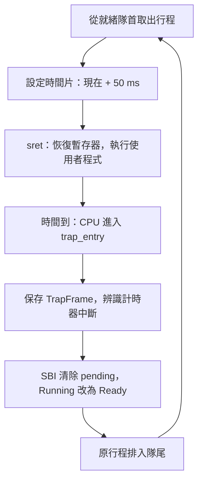
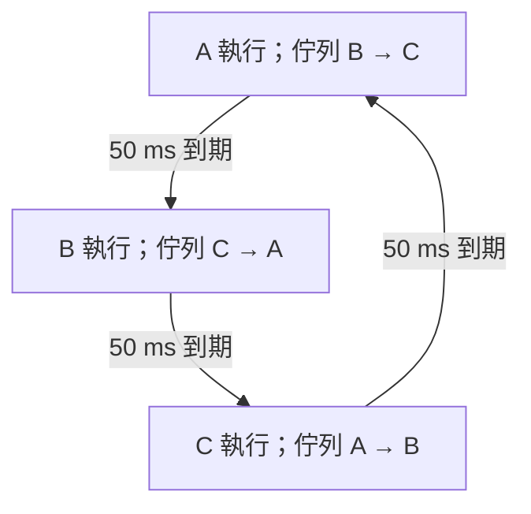

<script setup>
import SchedulingLab from '../.vitepress/theme/components/SchedulingLab.vue'
</script>

# 05 · 計時器與 RR 排程

<SchedulingLab />

## Overview

**WUWAOS 目前使用固定 50 ms 時間片的 RR（Round Robin，輪詢排程）**。就緒行程仍以 FIFO（先進先出）順序排隊；在使用者模式執行的行程若時間片到期，核心會切換行程。互動圖使用固定的小型工作負載說明 RR 計算，不讀即時 OS 狀態。

派發機制已改為 [Spec 16 的核心上下文切換](./processes.md#核心函式如何暫停與恢復)：透過 `swtch.S` 往返獨立排程器堆疊，保存暫停中的核心函式；50 ms RR 政策維持不變。

RR 是先進先出的 ready queue 加上有限時間片。行程用完時間片仍未完成，就回到隊尾；若提早完成、阻塞或主動 yield，則不會佔住 CPU 等到 quantum 用盡。教材工作負載刻意只包含 arrival 與 CPU burst，沒有 I/O、優先權、多核心或核心執行成本。

## Architecture

### 硬體如何讓使用者程式暫停

核心透過 OpenSBI TIME（韌體計時服務）設定「目前硬體時間 + 50 ms」。到期後，CPU 收到 Supervisor timer interrupt（監督模式計時器中斷），跳到 `stvec`（監督模式陷阱入口暫存器）指定的入口。



硬體不需要等待程式呼叫函式。`sepc`（保存的執行位置）已是恢復位置，不能像 `ecall` 那樣加 4；`a0`（參數／返回值暫存器）也必須原樣保留。

### Ready queue 與 RR 輪轉

Ready queue（就緒佇列）只串接 Ready PCB（就緒行程控制區塊）。head／tail（隊首／隊尾）讓入列與取隊首為 O(1)，移除特定節點最壞 O(N)。Running、Waiting、Zombie 不留在佇列；`ready_queued` 避免重複入列。



只有一個可執行行程時，它可重新獲選並取得下一個時間片。喚醒與新建行程排隊尾，不立刻搶走目前尚未到期的時間片。

## Step-by-step

下方示例固定三個工作：A 在 0 ms 抵達、burst 95 ms；B 在 25 ms 抵達、burst 60 ms；C 在 40 ms 抵達、burst 35 ms。可將教學 quantum 調為 25、50 或 100 ms，或逐步播放 queue、remaining 與 Gantt。每個 frame 是某個 slice 執行結束、期間到達的工作入列、未完成工作回到隊尾後的狀態；時間線只顯示已執行的 slice。

## Implementation

### 派發與時間片

每次取得可執行行程時，scheduler 從 queue head 移除它、將狀態轉成 Running，計數 dispatch，切換至該行程頁表並設定 50 ms timer。時間片到期後，timer trap 呼叫 `process_preempt()`：目前行程計數 preemption、轉回 Ready（因此入隊尾），停止 timer，保存工作狀態後切回 scheduler stack。`context_switch` 保存的是一般 C 呼叫邊界的 callee-saved state；完整使用者 TrapFrame 由 trap 路徑另外保存。

### 系統呼叫、yield 與阻塞

普通 syscall 或合法缺頁處理完，若原行程仍是 Running，就保留原 deadline（到期時間）。因此不停呼叫 `getpid` 也不能讓時間片一直歸零。

`yield`（主動讓出）會放棄剩餘時間並排隊尾；阻塞或退出也放棄時間片。重新被派發時才取得新的 50 ms，不累積未用完的預算。

### Ready queue 實作

scheduler queue 使用 head、tail 與 count。enqueue 對已在佇列的 PCB 不重複加入；`scheduler_next` 移除 head 並清除 PCB 的 queue link/flag；指定 PCB 的移除則沿鏈結尋找前節點。Process state transition 擁有 enqueue/remove 呼叫，避免排程策略與狀態更新分家。

### 在 QEMU 觀察

```text
ps
run counter
run counter
wakeup 9
ps
```

`ps` 列出 RR、`quantum_ms=50`、`timer_interrupts` 與就緒順序；PCB 加上 `dispatches`（派發次數）與 `preemptions`（時間片到期次數）。依實際 PID 執行 `pcb <pid>` 與 `wait <pid>`。

counter 每輪會 yield，交替輸出只能展示輪轉，不能單憑它證明計時器搶占。真正的無 yield 驗證透過 QEMU 偵錯介面讓既有 worker 執行映像中已存在的迴圈，沒有新增測試程式，見 [Spec 15](../SPEC-15-timer-rr.md)。短程式可能在時間片前結束，中斷數為 0 也正常。

## Source mapping

| 模組 | 責任與原始碼 |
| --- | --- |
| Clock（硬體時間） | [clock.h](https://github.com/johnson931128/WUWAOS/blob/main/arch/riscv/clock.h)：`rdtime`、10 MHz 時基、毫秒換算，動畫與磁碟逾時共用 |
| SBI（韌體介面） | [sbi.c](https://github.com/johnson931128/WUWAOS/blob/main/arch/riscv/sbi.c)：查詢 TIME 支援並設定絕對到期時間 |
| Timer（計時器） | [timer.c](https://github.com/johnson931128/WUWAOS/blob/main/arch/riscv/timer.c)：設定／停用事件、清除 pending（待處理中斷）、累計中斷數 |
| Timer API | [timer.h](https://github.com/johnson931128/WUWAOS/blob/main/arch/riscv/timer.h)：timer start/stop/interrupt 介面 |
| Scheduler（排程器） | [scheduler.c](https://github.com/johnson931128/WUWAOS/blob/main/kernel/proc/scheduler.c)：FIFO ready queue；[scheduler.h](https://github.com/johnson931128/WUWAOS/blob/main/kernel/proc/scheduler.h)：固定 `SCHEDULER_QUANTUM_MS = 50` |
| Process（行程管理） | [process.c](https://github.com/johnson931128/WUWAOS/blob/main/kernel/proc/process.c)：狀態、派發、yield/preempt、頁表與保存狀態 |
| Trap（陷阱分派） | [trap.c](https://github.com/johnson931128/WUWAOS/blob/main/arch/riscv/trap.c)：辨識 timer interrupt 並呼叫 `process_preempt` |
| Context switch | [context.h](https://github.com/johnson931128/WUWAOS/blob/main/arch/riscv/context.h) 與 [swtch.S](https://github.com/johnson931128/WUWAOS/blob/main/arch/riscv/swtch.S)：保存／還原 `ra`、`sp` 與 `s0–s11` |

## Failures / Limitations

### 核心為什麼仍不搶占

初始使用者狀態設 `sstatus.SPIE`（陷阱返回後中斷啟用狀態），並開啟 `sie.STIE`（允許計時器中斷）。進入核心後，`SIE`（監督模式中斷全域開關）保持關閉，處理完才返回使用者模式。

單核心的頁表、行程表與 VirtIO 佇列不會在修改一半時被 timer 搶占。Gate 競爭與 runtime Block request 都可讓呼叫者透過 event wait 自願切到 scheduler；poll 收到裝置完成後，再恢復原呼叫。Boot 裝置初始化仍可同步輪詢。長 syscall、CPU 繪圖與大段記憶體複製仍可能延後搶占；**50 ms 並非嚴格的最大回應時間，也不是精確 CPU burst 統計**。

若沒有 Ready 行程但仍有 event 或 UI poll work，排程器使用固定的短絕對 deadline arm SBI timer，於 `SIE=0` 下執行 `WFI`；`sie.STIE` 保持開啟，因此本地 timer pending 可喚醒 WFI，而 trap handler 不會進入 S-mode timer interrupt。返回後先停止／確認 timer，再輪詢 UART、UI 與 event timeout。Spurious wake 會沿用原絕對 deadline，避免無限延後。這是 idle polling 節能等待，不改 50 ms RR quantum，也不是裝置中斷驅動。

### 教學模型與核心的差異

互動元件重算的是固定 arrival/burst 工作負載；quantum 可調是為了比較 RR 行為，並不呼叫核心、不取得 `ps`/`workstate` 統計，也不改核心 timer 常數。模型假設單核心、CPU-only burst，沒有 I/O 阻塞、核心工作成本、wake-up、yield、中斷延遲或多核心競爭；Gantt 寬度表示模型毫秒，不是真實 CPU 統計。

## Further Reading

- 本地課程筆記：[notes/ch5 CPU schedueling.md](../../notes/ch5%20CPU%20schedueling.md)，Round-Robin 基本定義（§「RR 核心定義與硬體依賴」）與 FIFO queue 概念。教材中的一般 RR 模型與 C++ 示例是教科書概念；本站互動器是有限 workload 計算，核心實作則由上述 WUWAOS source 決定。
- 原始合作式 FIFO 設計保留於 [Spec 07](../SPEC-07-fifo-scheduler.md)，現行設計以 [Spec 15](../SPEC-15-timer-rr.md) 為準。
- [OSTEP CPU Scheduling](https://research.cs.wisc.edu/wind/OSTEP/cpu-sched.pdf) §7.7：RR time slice 與工作負載推演。
- [OSTEP VizTools Scheduling](https://srg-ics-uplb.github.io/cmsc125/viztools/scheduling/) 與 [OS Lab CPU Scheduling](https://oslab.xikai.me/cpu-scheduling)：互動步驟與 queue/Gantt 視圖參考。

RR 決定誰取得 CPU；[頁面置換 FIFO](./paging.md) 決定誰讓出實體頁框。CPU 政策改變，不會把記憶體置換也改成 RR。尚無優先權、多核心排程、核心內搶占與完整終端工作控制。
