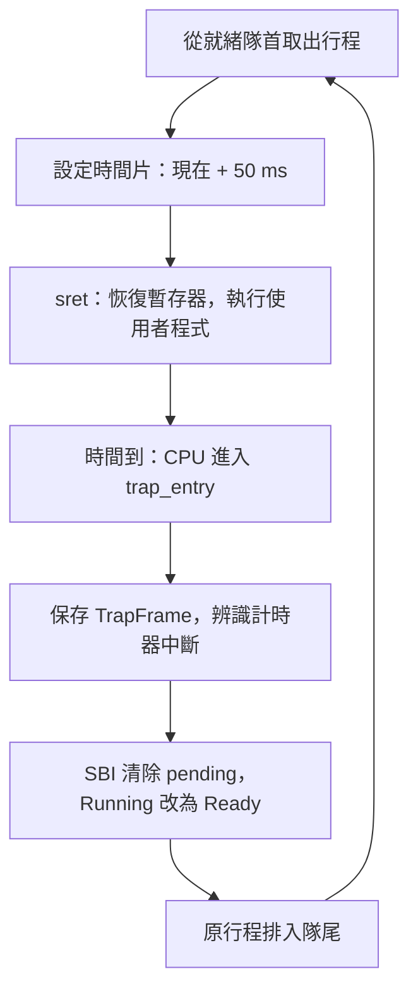
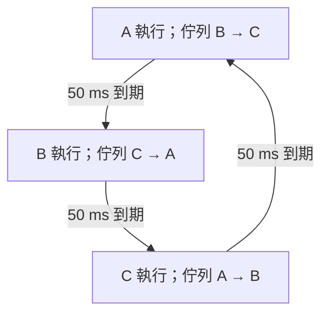

# 05 · 計時器與 RR 排程

**目前是 50 ms 時間片的 RR（Round Robin，輪詢排程）**。就緒行程仍以 FIFO（先進先出）順序排隊，但執行中的程式即使不主動 yield，也會在時間片到期時被核心換下。

## 硬體如何讓程式暫停

核心透過 OpenSBI TIME（韌體計時服務）設定「目前硬體時間 + 50 ms」。到期後，CPU 收到 Supervisor timer interrupt（監督模式計時器中斷），跳到 stvec（監督模式陷阱入口暫存器）指定的入口。



硬體不需要等待程式呼叫函式。sepc（保存的執行位置）已是恢復位置，不能像 ecall 那樣加 4；a0（參數／返回值暫存器）也必須原樣保留。

## 模組分工

| 模組 | 責任與原始碼 |
| --- | --- |
| Clock（硬體時間） | [clock.h](https://github.com/johnson931128/WUWAOS/blob/main/kernel/clock.h)：rdtime、10 MHz 時基、毫秒換算，動畫與磁碟逾時共用 |
| SBI（韌體介面） | [sbi.c](https://github.com/johnson931128/WUWAOS/blob/main/kernel/sbi.c)：查詢 TIME 支援並設定絕對到期時間 |
| Timer（計時器） | [timer.c](https://github.com/johnson931128/WUWAOS/blob/main/kernel/timer.c)：設定／停用事件、清除 pending（待處理中斷）、累計中斷數 |
| Scheduler（排程器） | [scheduler.c](https://github.com/johnson931128/WUWAOS/blob/main/kernel/scheduler.c)：就緒佇列；時間片常數在 scheduler.h |
| Process（行程管理） | [process.c](https://github.com/johnson931128/WUWAOS/blob/main/kernel/process.c)：狀態、派發、頁表與保存狀態 |
| Trap（陷阱分派） | [trap.c](https://github.com/johnson931128/WUWAOS/blob/main/kernel/trap.c)：區分系統呼叫、缺頁與計時器中斷 |

## 就緒佇列與輪轉

Ready queue（就緒佇列）只串接 Ready PCB（就緒行程控制區塊）。head／tail（隊首／隊尾）讓入列與取隊首為 O(1)，移除特定節點最壞 O(N)。Running、Waiting、Zombie 不留在佇列；ready_queued 避免重複入列。



只有一個可執行行程時，它可重新獲選並取得下一個時間片。喚醒與新建行程排隊尾，不立刻搶走目前尚未到期的時間片。

## 系統呼叫會重新計時嗎

不會。普通 syscall 或合法缺頁處理完，若原行程仍是 Running，就保留原 deadline（到期時間）。因此不停呼叫 getpid 也不能讓時間片一直歸零。

yield（主動讓出）會放棄剩餘時間並排隊尾；阻塞或退出也放棄時間片。重新被派發時才取得新的 50 ms，不累積未用完的預算。

## 核心為什麼仍不搶占

初始使用者狀態設 sstatus.SPIE（陷阱返回後中斷啟用狀態），並開啟 sie.STIE（允許計時器中斷）。進入核心後，SIE（監督模式中斷全域開關）保持關閉，處理完才返回使用者模式。

單核心的頁表、行程表與 VirtIO 佇列不會在修改一半時被切走。代價是長 syscall、同步磁碟 I/O 或 Swap 會延後搶占；**50 ms 並非嚴格的最大回應時間，也不是精確 CPU burst 統計**。全員等待 UART 時停用計時器事件，仍採輸入輪詢。

## 在 QEMU 觀察

```text
ps
run counter
run counter
wakeup 9
ps
```

ps 列出 RR、quantum_ms=50、timer_interrupts 與就緒順序；pcb 加上 dispatches（派發次數）與 preemptions（時間片到期次數）。依實際 PID 執行 `pcb <pid>` 與 `wait <pid>`。

counter 每輪會 yield，交替輸出只能展示輪轉，不能單憑它證明計時器搶占。真正的無 yield 驗證透過 QEMU 偵錯介面讓既有 worker 執行映像中已存在的迴圈，沒有新增測試程式，見 [Spec 15](../SPEC-15-timer-rr.md)。短程式可能在時間片前結束，中斷數為 0 也正常。

## 與頁面 FIFO 的區別

RR 決定誰取得 CPU；[頁面置換 FIFO](./paging.md) 決定誰讓出實體頁框。CPU 政策改變，不會把記憶體置換也改成 RR。

觀念參考：`notes/ch5 CPU schedueling.md` 的 Round-Robin 理論與非搶占式核心。原始合作式 FIFO 保留於 [Spec 07](../SPEC-07-fifo-scheduler.md)，現行設計為 [Spec 15](../SPEC-15-timer-rr.md)。尚無優先權、多核心排程、核心內搶占與完整終端工作控制。
